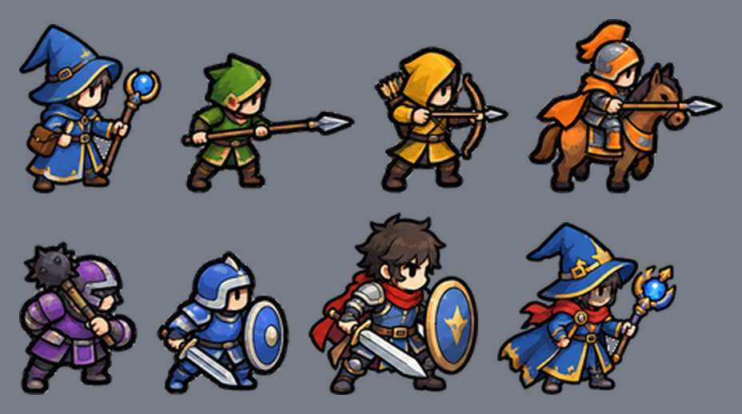

# 에셋 제작 프롬프트 (이미지 생성 AI / 아티스트 의뢰용)

프롬프트는 영어로 써 두었습니다(이미지 생성 AI가 영어를 더 잘 따릅니다). 그대로 복사해서 쓰시면 됩니다.

## 진행 상황

| 에셋 | 상태 |
|---|---|
| 병종 유닛 10종 (아군·적 각 5) | 완료, 게임에 적용됨 (`client/public/assets/units/`) |
| 주인공 (무기별 포즈) | 완료, 적용됨 (`assets/hero/`). 기병 포즈는 아직 쓸 곳이 없어 보관 |
| 마법사 (아군·적 유닛, 주인공 지팡이 포즈, 카드 일러스트) | 아군·주인공·카드는 적용됨(`units/ally_mage.png`, `hero/hero_mage.png`, `cards/art_mage.png`). 적 마법사 그림(`units/enemy_mage.png`)은 적이 아직 마법사를 쓰지 않아 보관 |
| 운석 이펙트 (낙하 6컷·폭발 5컷·바닥 그을음 5컷) | 완료, 적용됨 (`assets/fx/meteor_*`, `boom_*`, `scorch_*`) |
| 캠프 | 완료, 적용됨 (`assets/camp/camp.png`) |
| 바닥 타일 | 완료, 적용됨 (`assets/tiles/ground_a.png`) |
| 투사체 (화살, 아군·적 각 5컷) | 완료, 적용됨 (`assets/fx/`). 속도선 컷으로 날아가고 명중 컷을 잠깐 보여 줌 |
| 레벨업 카드 아이콘 19종 | 이 문서 7번 |
| 무기·HUD 아이콘 | 이 문서 8번 |
| 기병 장군 본체 2포즈(스테이지 1 보스) | **메인 화풍으로 재제작해 적용됨(베타 1.287)**: `assets/units/boss1_idle.png`(240x303), `boss1_attack.png`(268x295). 예전 그림은 `boss1_idle_old`·`boss1_attack_old`로 보관. 체크무늬 가짜 투명 배경은 `tools/remove_checker_bg.py`로 지우고 `tools/fix_halo.py`로 밝은 테두리를 정리했다. 화면 배율 0.5에서 아군 기병의 약 2.2배 크기 |
| 기병 장군 선회 베기 호·돌격 함성 오라 | 흰 배경 재요청본을 받아 적용 준비 완료, 보관 (`assets/fx/boss1_slash_0~3.png`, `boss1_cry_0~2.png`). **돌격 함성 3번 컷은 못 받음**(고리가 완전히 닫힌 컷). 처음에 받은 시안에서 오려 둔 이전 그림은 `*_old.png`로 보관 |
| 기병 장군 돌진 충돌 임팩트 | 섬광 2장(`boss1_impact_0`, `0b`)과 흰 배경 재요청본 연기 3컷(`boss1_impact_1~3`) 모두 받음, 보관 (`assets/fx/`). 3번 연기는 반투명이라 옅다 |
| 창병 장군 본체 3포즈 | **메인 화풍으로 재제작해 적용됨(베타 1.288)**: `assets/units/boss2_idle.png`(188x329), `boss2_guard.png`(252x209), `boss2_thrust.png`(258x206). 예전 그림(여분 `boss2_guard_b` 포함)은 `_old`로 보관. 받은 시안에서 손본 것: 체크무늬 배경 제거, 발 밑 지면선 삭제, **찌르기 포즈의 창날이 캔버스 끝에서 잘려 있어 방어 포즈의 같은 창날을 이어 붙여 복원**, 창날 안쪽 하이라이트가 배경으로 지워진 곳 채움. 다음에 요청할 때는 "캔버스 오른쪽에 창끝 여백을 둘 것, 지면선을 그리지 말 것"을 덧붙인다 |
| 창병 장군 이펙트 (장창 찌르기 선 3컷, 창 방어 쓸기 3컷, 던진 창, 박힌 창) | 받음, 보관 (`assets/fx/boss2_thrust_0~2`, `boss2_sweep_0~2`, `boss2_spear_fly`, `boss2_spear_stuck`). 시안의 테두리 선은 잘라 냈다. 연한 초록 이펙트는 반투명으로 처리해 옅게 보인다 |
| 궁병 장군 본체 3포즈 | **메인 화풍으로 재제작해 적용됨(베타 1.289)**: `assets/units/boss3_idle.png`(225x271), `boss3_aim.png`(231x271), `boss3_sky.png`(223x288). 예전 그림은 `_old`로 보관. 제미나이 시안에서 손본 것: 단색 회색 배경 제거(`tools/remove_flat_bg.py`), 오른쪽 아래 제미나이 별 로고와 그에 가려진 신발창 복원, 활시위가 모자·얼굴·몸을 가로지르던 선을 지워 "시위가 머리 뒤로 지나가는" 모습으로 정리. 이펙트(`assets/fx/boss3_*`: 얼음 화살·저격 볼트·화살비 등)는 아직 예전 그림이라 본체와 화풍이 다르다 |
| 검방병 장군 본체 3포즈 | **메인 화풍으로 재제작해 적용됨(베타 1.290)**: `assets/units/boss4_idle.png`(252x286), `boss4_reflect.png`(241x270), `boss4_charge.png`(249x251). 예전 그림은 `_old`로 보관. 제미나이 시안(단색 회색 배경)에서 손본 것: 배경 제거(`tools/remove_flat_bg.py --tol 8`, 허용 오차가 크면 칼날 안쪽이 배경으로 지워져서 줄임), 오른쪽 아래 제미나이 별 로고 삭제. 이펙트(`assets/fx/boss4_*`: 방패막·반사·무적·방패 돌진 등)는 아직 예전 그림이라 본체와 화풍이 다르다 |
| 둔기병 장군 본체 3포즈 | **메인 화풍으로 재제작해 적용됨(베타 1.291)**: `assets/units/boss5_idle.png`(264x256), `boss5_jump.png`(244x284), `boss5_smash.png`(287x204). 예전 그림은 `_old`로 보관. 제미나이 시안(단색 회색 배경)에서 `tools/remove_flat_bg.py`로 배경을 지우고 라벨을 잘라 냈다. 철퇴 모양이 예전의 원통형에서 **가시 박힌 공 모양**으로 바뀌었다. 휘두르기 2포즈(`boss5_swing_a`·`boss5_swing_b`, 586x258 같은 캔버스, 발 중심 정렬)는 베타 1.292에서 교체됨. 도는 포즈 4방향(`boss5_whirlpose_0~3`, 363x245 같은 캔버스)도 베타 1.293에서 교체되어 **본체 9포즈가 모두 새 그림**이다. 이펙트(`assets/fx/boss5_*`)는 아직 예전 그림이다. 이펙트(`assets/fx/boss5_*`)도 예전 그림이다 |
| 둔기병 장군 철퇴 난타 이펙트 | 받음, 적용됨 (`assets/fx/boss5_flurry_arc_0~2` 휘두르는 호, `boss5_flurry_hit_0~2` 타격 임팩트 3컷). 보스 휘두르기 포즈 2장 받아 적용(`assets/units/boss5_swing_a`(젖힌 자세)·`boss5_swing_b`(휘두르는 자세), 발 위치를 맞춘 같은 크기 캔버스) |
| 둔기병 장군 휠윈드 소용돌이·도는 포즈 | 받음, 보관 (`assets/fx/boss5_tornado_a_0~3`, `boss5_tornado_b_0~3` 소용돌이 4컷 두 벌, `assets/units/boss5_whirlpose_0~3` 도는 장군 앞·옆·뒤·옆 4방향). 깔때기 소용돌이(tornado)는 원하는 모양이 아니어서 쓰지 않는다(보관). 휠윈드는 `boss5_spin_0~3`(속 빈 고리)을 바닥·몸통 높이에 두 겹으로 쓴다 |
| 네크로맨서(9스테이지) 1차 | 받음, 보관(아직 게임에 연결 안 함): `assets/units/boss9_idle·boss9_cast·boss9_drain`(본체 3포즈), `assets/fx/boss9_fog_burst_0~3`(안개 퍼짐)·`boss9_fog_0~3`(안개 반복), `boss9_orb_0~2`·`boss9_orb_hit_0~3`(영혼 구슬 평타), `assets/units/skel_cavalry·skel_spear·skel_archer·skel_sword·skel_blunt·skel_mage`(스켈레톤 6종). 안개는 가운데에 갇힌 흰 배경과 생성 도구 로고 조각을 지웠다 |
| 네크로맨서 2차 | 받음, 보관(아직 게임에 연결 안 함): `assets/fx/boss9_corpse`·`boss9_revive_0~3`·`boss9_rise_0~3`(시체·소생), `boss9_drain_ring_0~3`(흡수 범위 고리, 중심을 맞춤)·`boss9_drain_beam`·`boss9_drain_mote_0~2`(생명 흡수), `boss9_chain_link`·`boss9_chain_mark_0~2`·`boss9_chain_break_0~2`(영혼 사슬). 고리 안쪽의 갇힌 흰 배경을 지웠다. **아직 없음**: 본체 포즈 `boss9_fog`(안개 뿌리기)·`boss9_chain`(사슬)(`boss9_cast`로 임시 대체 가능) |
| 검방병 장군 반사 등딱지 | 받음: `assets/fx/boss4_shell_0~4`(반복 5컷), `boss4_shell_hit_0~2`(반사 때 섬광) |
| 기마궁수 본체 2포즈·이펙트 | 받음, 보관 (`assets/units/boss7_gallop`, `boss7_shoot`, `assets/fx/boss7_fire_0~2`, `boss7_fire_out`, `boss7_lasso`, `boss7_lasso_hit`, `boss7_bound`, `boss7_cornered_0~2`). **후방 사격 `boss7_back`은 못 씀**: 한 칸에 두 자세가 서로 겹쳐 그려져 있어 떼어 낼 수 없다. 다시 받아야 한다(한 자세만 따로, 말 위에서 몸을 뒤로 틀어 왼쪽으로 쏘는 모습) |
| 전차 본체 2상태·이펙트 | 받음, 보관 (`assets/units/boss8_normal`, `boss8_mad`(광분, 바퀴가 붉게 달아오른 모습)와 같은 시안의 다른 한 장 `boss8_normal_b`, `boss8_mad_b`, `assets/fx/boss8_rampage_0~3`, `boss8_crash_1~4`, `boss8_dazed_0~3`, `boss8_scythe_0~3`, `boss8_heat_0~3`, `boss8_dust_0~3`). 시안에 같은 상태가 두 장씩 세로로 붙어 있어 가까운 쪽으로 갈라 냈다(`_b` 쪽은 가장자리에 다른 그림 조각이 조금 남아 있다). 충돌 섬광 `boss8_crash_0`은 흰 섬광이라 못 씀(`boss1_impact_0`으로 대신) |
| 공성전 1차 그림 | 적용됨(베타 1.190): `assets/units/boss10_idle·scepter·cast`(군주), `boss10_guard_*`(근위대·정예 기병), `assets/fx/boss10_gate_0~2·open·ruin`(성문), `boss10_wall_a~c`·`boss10_tower`(성벽·탑), `boss10_oil_0~3`(끓는 기름). 시트의 칸 선은 `tools/slice_siege.py`로 지웠다 |
| 공성전 이펙트 5종 | 적용됨(베타 1.191): 결계 `boss10_ward_0~3`, 벼락 `boss10_bolt_0~3`, 호령 `boss10_rally_0~3`, 근위대 소집 `boss10_summon_0~3`, 홀 내려찍기 `boss10_slam_0~4`. 칸마다 같은 기준점으로 잘랐다(`tools/slice_siege.py --cells`). 성루 투석 바위 `boss10_boulder`도 적용됨(베타 1.192) |
| 효과음·음악 | 이 문서 10번 |
| 스페이스 스킬 아이콘 6종 | 완료, 적용됨 (`assets/ui/skill_icon_*.png`, 철퇴는 시안 2개 중 `skill_icon_mace`를 쓰고 `skill_icon_mace_b`는 보관) |
| 방벽 상태 3컷(평면 띠 시안) | 보관 (`assets/fx/skill_wall_0~2.png`). 조각 그림이 있으면 쓰이지 않음 |
| 방벽 수정 가운데 3조각 | 적용됨 (`skill_wall_seg_0~2.png`, 상태마다 한 장을 선을 따라 쌓음) |
| 방벽 수정 조각 9개 | 보관(3조각이 없을 때 대체) (`assets/fx/skill_wall_<상태>_<a~c>.png`, 윤곽선을 덧입혀 사용, 원본은 `skill_wall_raw/`). 부서짐·생성 모션은 아직 |
| 철퇴 투척 그림 | 적용됨 (`assets/fx/skill_mace_thrown.png`, `skill_mace_trail_0~2.png`, `skill_mace_hit_0~3.png`). 받은 시안에서 오려 냄. 충격은 4컷(5컷 중 앞쪽 흐린 컷 제외), 소리 2종은 아직 |
| 창 돌진 잔상 | 코드로 주인공 모습을 어둡게 복사해 남김(그림 불필요). 받은 옆모습 시안 `skill_dash_0~4.png`는 보관만 함 |
| 기마 가속 바람 궤적 6컷 | 적용됨 (`assets/fx/skill_boost_0~5.png`, 받은 시안에서 오려 냄). 흙먼지·시작·해제 컷은 아직 |
| 스페이스 스킬 나머지 이펙트·소리 | 이 문서 11번. 아직 에셋이 없어 도형과 고리로 대신 그리는 중 |

### 이미지 생성 도구가 투명 배경을 주지 않을 때

생성 도구가 투명 PNG 대신 **흰 배경(체크무늬 잡음이 구워진 가짜 투명)** 이미지를 주는 경우가 많습니다. 처음 유닛 시트는 진짜 투명이었지만 주인공·캠프·화살은 흰 배경이었습니다. 그래도 문제없이 처리할 수 있습니다.

```sh
# 1) 흰 배경을 투명으로 (가장자리에서 이어진 흰색만 지우므로 그림 속 흰 하이라이트는 남는다)
python3 tools/remove_bg.py 원본.webp 투명.png
#   - 속도선·폭발 같은 반투명 이펙트가 있으면:  --effects --threshold 215
#   - 활과 시위 사이처럼 '닫힌 구멍 속 배경'이 남으면 그 위치를 지정:  --pocket-box x0,y0,x1,y1
# 2) 시트를 한 장씩 자르기
python3 tools/slice_sheet.py 투명.png client/public/assets/<폴더> --names a,b,c --rows 1 --scale 0.4
#   - 속도선처럼 본체와 떨어진 조각이 있으면:  --attach 120 --min-height 40
```

이번에 쓴 명령(다시 만들 때 그대로 쓸 수 있음):

```sh
python3 tools/remove_bg.py 주인공.webp /tmp/hero.png --pocket-box 790,390,880,550
python3 tools/slice_sheet.py /tmp/hero.png client/public/assets/hero --names hero_cavalry,hero_spear,hero_archer,hero_sword,hero_mace --rows 1 --scale 0.4
python3 tools/remove_bg.py 캠프.webp /tmp/camp.png
python3 tools/slice_sheet.py /tmp/camp.png client/public/assets/camp --names camp --rows 1 --scale 0.4 --min-height 300
python3 tools/remove_bg.py 화살.webp /tmp/arrows.png --effects --threshold 215
python3 tools/slice_sheet.py /tmp/arrows.png client/public/assets/fx --names arrow_ally_0,arrow_ally_1,arrow_ally_2,arrow_ally_3,arrow_ally_4,arrow_enemy_0,arrow_enemy_1,arrow_enemy_2,arrow_enemy_3,arrow_enemy_4 --rows 2 --scale 0.3 --min-height 40 --attach 120
# 바닥은 512x512로 줄여 tools/tile_preview.py 로 이음새 점수를 확인
```

## 0. 먼저 읽어 주세요 (그림체와 시트 형식)

**1. 메인 그림체(확정): 아군 5병종 유닛 + 주인공.** 새 그림은 모두 이 화풍에 맞춥니다. 요청할 때마다 **기준 이미지 `docs/style-reference/main_style_sheet.png`(아군 5병종 + 검방병 + 주인공 2종)를 스타일 기준(reference)으로 같이 첨부**하세요. 이 방식을 빼면 사실적으로 나옵니다(방벽 시안이 그랬습니다).



**왜 이 화풍인가**: 캐주얼 2D 게임이라서 작게 줄여도 알아보는 큰 머리의 귀여운 비율과 굵은 외곽선이 맞습니다.

**화풍 규칙(기준 그림 10장을 실제로 잰 값)**

| 항목 | 규칙 | 잰 값 |
|---|---|---|
| 시점 | 옆모습(위에서 내려다본 시점 아님), 오른쪽을 보고 선 자세 (왼쪽으로 갈 때 코드가 좌우 반전) | - |
| 비율 | **치비: 머리(모자·깃털 제외)가 전체 키의 약 45~50%**, 얼굴은 넓고 둥글게(눈은 얼굴 아래쪽에 낮게 붙임), 몸통·팔다리는 짧고 통통하게. 호리호리하거나 키 큰 어른 비율 금지. 보스도 몸집이 큰 것이지 비율은 유닛과 같다 | 높이 88~114px(기병·주인공이 큼) |
| 외곽선 | **거의 검정**(`#050505` 부근) 굵은 선, 바깥쪽에 밝은 테두리를 남기지 않기 | 두께 약 2~3px, 색 RGB 1~14 |
| 색칠 | 면을 2~3톤으로 나눈 평평한 색칠(만화풍). 그라데이션·무지개빛 광택·사실적 질감 금지 | - |
| 채도·밝기 | 팀 색이 한눈에 보이게 선명하되 너무 짙지 않게 | 채도 0.30~0.62, 평균 밝기 0.22~0.31, 대비 0.51~0.76 |
| 아군·적 | 아군은 밝고 선명하게, 적은 어둡고 탁하게(붉은 포인트) | - |
| 얼굴 | **아주 단순하게**: 눈은 작은 검은 점이나 타원(흰자위·홍채·속눈썹 없음, 작은 흰 하이라이트 점 정도), 눈썹은 굵은 선 하나, 코는 생략하거나 점 하나, 입은 짧은 선, 귀는 둥글게 생략하거나 작게. 얼굴 그림자·가는 선 묘사 금지 | 기준 시트의 주인공·아군 얼굴을 따른다 |
| 투명 배경 | 흰 배경을 지울 때 **외곽선 바깥에 밝은 테두리가 남지 않게**. 남으면 `python3 tools/fix_halo.py`로 고친다 | 맨 바깥 링 밝기 차 0 |

**보스도 이 화풍으로 맞춥니다(재제작 대상).** 지금 보스 그림은 사실적인 비율·어두운 색조·약한 대비라서 유닛과 다른 게임처럼 보입니다. 위압감은 **크기(일반 유닛의 2~2.5배), 소품(큰 무기·망토·왕관), 색(어둡지만 채도는 유지), 자세**로 내고, **그림체 자체는 위 규칙 그대로**(치비 비율, 같은 외곽선, 평평한 색칠)로 합니다.
- 재제작 목록(포즈 / 이펙트 수): 보스1 2/12, 보스2 4/8, 보스3 3/18, 보스4 3/25, 보스5 9/31, 보스6 3/24, 보스7 2/10, 보스8 5/24, 보스9 3/39, 보스10 18/69. 이펙트는 유닛과 별개로 **외곽선 없이 색과 밝기로** 만들어도 되지만, 채도·밝기 범위는 유닛 규칙을 따릅니다.
- 순서 제안: 보스 본체 포즈부터(눈에 가장 띄는 것) → 자주 쓰는 이펙트. 한 보스씩 만들어 `python3 tools/asset_outliers.py`로 기존 그림과 비교해 확인합니다.
- 새로 만든 그림은 넣기 전에 `python3 tools/asset_outliers.py`로 튀는지 보고, 밝은 테두리가 남았으면 `tools/fix_halo.py`로 고칩니다. 기존 그림은 `_old`로 보관합니다(삭제 금지).

**2. 한 장에 여러 개를 뽑는 "시트" 형식으로 요청하세요.** `tools/slice_sheet.py`가 시트를 한 장씩 자릅니다. 잘리려면 이 규칙을 지켜야 합니다.

- **투명 배경** PNG/WEBP
- 항목들은 격자로 배치하고, **서로 충분히 떨어뜨리기**(최소 한 항목 크기의 1/4 이상 여백). 닿거나 겹치면 한 덩어리로 묶입니다.
- 항목 아래에 작은 라벨(이름·파일명)은 있어도 됩니다. 라벨은 자동으로 버려집니다.
- 각 항목의 높이가 **시트 기준 100px 이상**이 되게(너무 작게 뽑으면 라벨로 오인되어 버려집니다). 해상도를 높게 요청하세요.
- **항목 수를 정확히** 지켜 주세요. 개수가 틀리면 도구가 알려 줍니다.

시트 요청 머리말(아래 시트 프롬프트 앞에 공통으로 붙임):

```
Reference: match the art style of the attached main-style sheet exactly (side view,
chibi proportions with a big head, thick near-black outline about 2-3px with no light
fringe outside it, flat cel-shaded colors in 2-3 tones, saturated but not neon, no
gradients, no realistic texture, no glossy highlights, a very simple face: eyes are small solid black dots or
ovals with at most a tiny white highlight, no iris, no white of the eye, no eyelashes, one thick simple eyebrow line,
no nose or just a tiny dot, a short line for the mouth, small rounded ears).
Output a sprite sheet on a fully transparent background, items arranged in a
clean grid with generous empty space between them, nothing touching or overlapping,
each item large and fully visible, a small caption with the file name under each item.
```

네거티브(지원하는 도구에서): `perspective, 3d render, isometric, top-down view, realistic, photo, blurry, noisy texture, background scenery, cropped, overlapping items`

## 1. 색 규칙 (코드와 화면이 이 색을 기준으로 씁니다)

| 병종 | 주색 | 무장 |
|---|---|---|
| 기병 | 주황 | 말을 탄 경기병, 가벼운 창 |
| 창병 | 초록 | 긴 창, 가죽·천 갑옷 |
| 궁병 | 노랑 | 활, 가벼운 복장, 화살통 |
| 검방병 | 파랑 | 검과 둥근 방패, 판금 |
| 둔기병 | 보라 | 철퇴, 두꺼운 갑옷 |

**카드 종류별 테두리 색**: 규모 = 금색, 용병 강화 = 초록, 주인공 강화 = 파랑.
**플레이어 구분 색**(8가지)은 **코드가 발밑 고리로 덧입히므로** 스프라이트에는 칠하지 마세요.

## 2. (참고) 이미 끝난 유닛 시트 프롬프트

그림체를 다시 맞춰야 할 때 참고용입니다.

```
<시트 요청 머리말>
10 fantasy mercenary soldiers in two rows of five. Top row (allies, bright saturated
colors): orange light cavalry rider on a horse with a short lance, green hooded
spearman with a long spear, yellow hooded archer with a bow and quiver, blue
sword-and-round-shield soldier in plate armor, purple heavy soldier with a spiked mace.
Bottom row (enemies): the same five, but dark desaturated colors with dark red accents
and battered armor.
```

## 3. 주인공 (무기 4종)

주인공은 용병보다 한눈에 띄어야 합니다. **몸은 같고 무기만 다른 4장**을 한 줄로 뽑습니다. 플레이어마다 발밑 고리 색이 달라서, 주인공 몸 색은 **중립(검정·회색·금색)** 으로 해 주세요(빨강·파랑·초록 같은 병종/플레이어 색은 피합니다).

```
<시트 요청 머리말>
4 variants of the same mercenary captain hero in one row, facing right, slightly
larger and more detailed than ordinary soldiers (about 1.2x). Dark charcoal cloak,
gold trim, white scarf, confident pose, no bright saturated colors on the body.
Each holds a different weapon: 1) a longbow drawn, 2) a long spear thrust forward,
3) a sword raised with the other hand open, 4) a large spiked iron mace over the shoulder.
Captions: hero_bow, hero_spear, hero_sword, hero_mace
```

- 파일 이름 순서: `hero_bow, hero_spear, hero_sword, hero_mace` (왼쪽부터)
- 자르기: `python3 tools/slice_sheet.py <시트> client/public/assets/hero --names hero_bow,hero_spear,hero_sword,hero_mace --rows 1 --scale 0.45`

## 4. 캠프

용병을 고용하는 곳입니다. 화면에서 **반경 120px의 노란 원** 안에 서 있는 것은 코드가 그리므로, 원 가운데에 놓일 **캠프 오브젝트 하나**만 만들면 됩니다. 멀리서도 "여기가 캠프"임이 보이게 **금색·주황 포인트**를 쓰세요.

```
<시트 요청 머리말>
A single mercenary camp object, side view: a canvas tent in warm brown and orange,
a small campfire with a little flame and a thin wisp of smoke, a tall banner pole with
a golden flag, two wooden crates. Compact silhouette that reads clearly when small.
Caption: camp
```

- 자르기: `python3 tools/slice_sheet.py <시트> client/public/assets/camp --names camp --rows 1 --scale 0.5`
- 선택: 만료가 임박한 캠프용으로 같은 그림에 불이 꺼지고 천막이 낡은 버전 `camp_old`를 더 만들면 좋습니다(2개를 한 줄로).

## 5. 바닥 타일

전투가 잘 보이는 것이 최우선입니다. **대비를 낮게**, 어둡게, 유닛이 올라갔을 때 묻히지 않게 해 주세요. 시트가 아니라 **이미지 한 장**으로 받습니다.

```
Seamless tileable ground texture for a 2D top-down-ish fantasy battlefield, dark muted
olive-brown grass and packed dirt, very low contrast, subtle noise and a few tiny
pebbles and grass tufts, no large objects, no paths, no text, no borders,
evenly distributed detail, 512x512, edges match for perfect tiling
```

- **반복해도 이음새가 보이지 않아야 합니다.** 받으신 파일로 `python3 tools/tile_preview.py ground.png`를 실행하면 3x3으로 이어 붙인 미리보기와 이음새 점수가 나옵니다.
- 이음새가 보이면 같은 프롬프트에 `seamless, tileable, wraps around on all four sides`를 반복해서 다시 뽑거나, 이미지 편집 도구의 "타일링(offset) 후 경계 보정"을 쓰세요.
- 선택: 변주용 `ground_b`(같은 색조, 돌/꽃 약간 더)를 만들어 두면 반복이 덜 티가 납니다.
- 파일 이름: `client/public/assets/tiles/ground_a.png`

## 6. 투사체 (화살)

작아서 시트 자르기보다 **이미지 두 장**으로 받는 편이 낫습니다. **오른쪽(→)을 향하게**, 투명 배경, 가로로 긴 모양.

```
A single arrow pointing right, side view, same thick-outline painterly style as the
attached sheet, wooden shaft with pale yellow fletching, steel tip, transparent
background, large and clearly visible
```
- `arrow_ally.png`: 위 그대로
- `arrow_enemy.png`: `dark red shaft and fletching, black tip, slightly rusty`

크기·여백 정리(자르기·축소)는 파일만 주시면 제가 하겠습니다.

## 7. 레벨업 카드 아이콘 (19종)

카드는 3종류입니다. 종류별로 **한 장씩 시트**로 뽑으세요(색을 통일하기 쉽습니다). 아이콘은 **한 가지 상징을 크게**, 굵은 윤곽선, 가운데 정렬, 카드 종류 색을 포인트로 씁니다.

공통 머리말:
```
<시트 요청 머리말>
Flat game UI icons in a grid, each a single bold symbol centered in a rounded-square
badge, same thick dark outline painterly style, <포인트 색> accent color on the badge
rim and highlights, no text inside the icons.
```

### 7-1. 규모 (금색) - 4개, 한 줄
`<포인트 색>` = `gold`

| 순서 | 파일 이름 | 카드 | 아이콘 |
|---|---|---|---|
| 1 | card_leadership1 | 통솔력 +1 | 깃발 하나 |
| 2 | card_leadership2 | 통솔력 +2 | 깃발 두 개 (또는 깃발 + 별) |
| 3 | card_price | 고용 비용 -15% | 금화 위에 아래 화살표 |
| 4 | card_loot | 전리품 +25% | 금화가 가득한 주머니 |

`python3 tools/slice_sheet.py <시트> client/public/assets/cards --names card_leadership1,card_leadership2,card_price,card_loot --rows 1 --scale 0.35`

### 7-2. 용병 강화 (초록) - 10개, 두 줄 x 다섯
`<포인트 색>` = `green`
- **윗줄 (전체 용병 강화 5)**:

| 순서 | 파일 이름 | 카드 | 아이콘 |
|---|---|---|---|
| 1 | card_merc_hp | 용병 체력 +15% | 병사 방패 + 하트 |
| 2 | card_merc_dmg | 용병 공격력 +12% | 병사 + 교차한 검 |
| 3 | card_merc_atkspeed | 용병 공격 속도 +10% | 검 + 번개 |
| 4 | card_merc_speed | 용병 이동 속도 +10% | 병사 + 날개 달린 신발 |
| 5 | card_merc_respawn | 빠른 재집결(부활 -20%) | 나팔(뿔피리) |

- **아랫줄 (병종 단련 5)**: 각 병종의 **고유 색**을 아이콘 몸통에, 별 하나를 모서리에 붙입니다.

| 순서 | 파일 이름 | 카드 | 아이콘 |
|---|---|---|---|
| 6 | card_boost_cavalry | 기병 단련 | 주황 말머리 + 별 |
| 7 | card_boost_spear | 창병 단련 | 초록 창 + 별 |
| 8 | card_boost_archer | 궁병 단련 | 노랑 활과 화살 + 별 |
| 9 | card_boost_sword | 검방병 단련 | 파랑 검과 방패 + 별 |
| 10 | card_boost_mace | 둔기병 단련 | 보라 철퇴 + 별 |

`python3 tools/slice_sheet.py <시트> client/public/assets/cards --names card_merc_hp,card_merc_dmg,card_merc_atkspeed,card_merc_speed,card_merc_respawn,card_boost_cavalry,card_boost_spear,card_boost_archer,card_boost_sword,card_boost_mace --rows 2 --scale 0.35`

### 7-3. 주인공 강화 (파랑) - 5개, 한 줄
`<포인트 색>` = `blue`

| 순서 | 파일 이름 | 카드 | 아이콘 |
|---|---|---|---|
| 1 | card_hero_hp | 최대 체력 +25 | 큰 하트 |
| 2 | card_hero_speed | 이동 속도 +8% | 날개 달린 부츠 |
| 3 | card_hero_dmg | 사격 피해 +25% | 화살 + 불꽃 |
| 4 | card_hero_firerate | 연사 속도 +15% | 화살 여러 개 |
| 5 | card_hero_regen | 체력 재생 | 하트 + 반짝임 |

`python3 tools/slice_sheet.py <시트> client/public/assets/cards --names card_hero_hp,card_hero_speed,card_hero_dmg,card_hero_firerate,card_hero_regen --rows 1 --scale 0.35`

> 카드가 새로 생기면(`shared/src/cards.ts`) 여기에 아이콘이 필요합니다. 아이콘이 없는 카드는 지금처럼 글자만 나오도록 두겠습니다.

## 8. 무기·HUD 아이콘

### 8-1. 무기 4개 (화면 오른쪽 아래 무기 바용), 한 줄
```
<시트 요청 머리말>
4 weapon icons in one row, each centered in a rounded-square badge, thick dark outline,
no text: a longbow with an arrow, a long spear, a sword with a small round shield,
a spiked iron mace. Silver-steel and wood tones.
Captions: weapon_bow, weapon_spear, weapon_sword, weapon_mace
```
`python3 tools/slice_sheet.py <시트> client/public/assets/ui --names weapon_bow,weapon_spear,weapon_sword,weapon_mace --rows 1 --scale 0.3`

### 8-2. HUD 아이콘 4개 (금화·체력·통솔력·레벨), 한 줄
```
<시트 요청 머리말>
4 small HUD icons in one row, each a single bold symbol with thick dark outline, no badge,
no text: a gold coin, a red heart, a small banner flag, a golden star.
Captions: icon_gold, icon_hp, icon_leadership, icon_level
```
`python3 tools/slice_sheet.py <시트> client/public/assets/ui --names icon_gold,icon_hp,icon_leadership,icon_level --rows 1 --scale 0.2`

## 9. 만든 에셋을 넘겨 주실 때

- 저장소에 올리거나 이 대화에 이미지를 보내 주세요. **시트 그대로** 주셔도 됩니다. 자르는 것은 제가 하겠습니다.
- 한 번에 다 만들지 말고 **주인공 → 캠프·바닥 → 카드 순서**로 진행하세요. 주인공·캠프·바닥이 들어가면 화면이 크게 바뀌므로, 먼저 그림체가 어울리는지 확인한 뒤 나머지를 만드는 편이 낫습니다.
- 받으면 게임에 적용한 뒤 **화면에서 크기, 겹침, 가독성**을 직접 보고 조정합니다. 용병이 수십 명 겹칠 때 알아볼 수 있는지가 기준입니다.
- 폴더: `client/public/assets/{units,hero,camp,tiles,cards,ui,audio}/`

## 10. 사운드 (효과음) 요청 목록

효과음 생성 도구(예: 텍스트로 효과음을 만드는 AI)나 음향 작가에게 그대로 붙여 넣는 문구입니다. 영어 문구가 도구에 잘 먹히므로 영어로 적었고, 괄호는 설명입니다.

### 10-0. 공통 규칙 (모든 소리에 같이 적어 주세요)

- **길이**: 대부분 0.1~0.5초. 꼬리(울림)를 짧게 끊습니다. 전투 중 같은 소리가 **초당 수십 번** 겹치므로, 길거나 날카로우면 금방 시끄럽습니다.
- **음색**: 둥글고 낮은 소리 위주. 3kHz 이상의 쨍한 고음, 귀를 찌르는 소리는 피합니다. 말소리는 넣지 않습니다.
- **변형**: 자주 나는 소리(화살, 타격, 방패, 사망)는 **같은 문구로 3~4개씩** 뽑아 주세요(`_1`, `_2`, `_3`). 게임이 번갈아 틀어 반복 느낌을 줄입니다.
- **형식**: WAV 또는 OGG, 44.1kHz, 모노(효과음) / 스테레오(음악·팡파르). 최대 볼륨 -1dB 이하, 소리끼리 크기 차이가 크지 않게 맞춰 주세요(작은 소리를 지나치게 키우지 않기).
- **분위기**: 어두운 판타지 전장(중세풍, 나무·가죽·쇠). 현대·SF 느낌 금지.
- **파일 이름과 위치**: `client/public/assets/audio/<이름>_<번호>.ogg` (예: `arrow_hit_1.ogg`). 아래 표의 **파일 이름**을 그대로 쓰면 코드 연결이 바로 됩니다.

### 10-1. 1순위: 이것만 있어도 체감이 큽니다 (10종)

게임에서 가장 자주, 가장 중요하게 일어나는 일입니다.

| 파일 이름 | 언제 나는가 | 문구 (영어) | 길이·변형 |
| --- | --- | --- | --- |
| `bow_shot` | 활을 쏠 때(주인공·궁병) | `short wooden bow release, dry string twang, no echo` | 0.2초, 2종 (3종을 요청했고 2종 적용됨, 하나 더 받으면 3종) |
| `arrow_volley` | 궁병 여럿이 동시에 쏠 때(화살 연사) | `volley of many arrows released at once, bowstrings snapping together then a rush of arrows through the air` | 0.8초, 1종 |
| `arrow_hit` | 화살이 적에게 맞을 때 | `soft arrow thud into leather and flesh, short, low volume` | 0.15~0.27초, 3종 |
| `melee_hit` | 근접 타격(검·창·철퇴로 몸을 때림) | `quick melee weapon hit, dull cloth and metal impact, medium thud` | 0.2~0.4초, 6종 |
| `shield_block` | 방패가 공격을 막을 때 | `wooden shield block, solid knock with a faint metal ring` | 0.2~0.45초, 4종 |
| `shield_break` | 방패가 깨질 때 | `shield shattering, splintering wood and a metal snap, short` | 1.2초, 1종 |
| `crit_hit` | 치명타 | `sharp critical strike, bright metallic slash with a heavy thump` | 0.3초, 8종 (충격음 8개 적용됨) |
| `enemy_die` | 적이 쓰러질 때 | `small fantasy soldier falls, short grunt-less thud and armor clatter, low volume` | 0.7~0.85초, 2종 |
| `armor_fall` | 적이 쓰러질 때 갑옷 소리(비명과 함께) | `metal armor body falling and clattering on the ground, short` | 0.6~0.8초, 5종 (적용됨) |
| `ally_hurt` | 내 유닛(주인공)이 맞을 때 | `player takes damage, dull body hit with short breathy grunt, not shrill` | 0.25초, 1종 |
| `level_up` | 레벨업 | `short uplifting level-up chime, warm bells, about one second` | 0.6초, 1종 |
| `boss_warning` | 보스군이 나타날 때 | `distant war horn blast, deep and ominous, two long notes, with faint marching drums` | 3초, 1종 |

### 10-2. 2순위: 게임의 맛을 살립니다 (17종)

| 파일 이름 | 언제 나는가 | 문구 (영어) | 길이·변형 |
| --- | --- | --- | --- |
| `spear_thrust` | 창을 찌를 때 | `quick spear thrust, short airy whoosh with a light tip impact` | 0.25초, 2종 |
| `sword_swing` | 검을 휘두를 때 | `light sword swing whoosh, short, slightly metallic` | 0.25초, 2종 |
| `mace_smash` | 철퇴 타격·범위 공격 | `heavy mace smash, deep low thud with a little crunch, short tail` | 0.4초, 2종 |
| `meteor_fall` | 마법사 운석이 떨어지기 시작할 때(약 0.6초 뒤 폭발) | `meteor falling from the sky, rising whoosh into a heavy explosion with a rumbling tail` | 6.6초, 1종 (사용자 제공 `meteo.aup4`에서 뽑아 -3dB·끝 페이드아웃) |
| `backstab` | 배후 공격 | `sneaky backstab slash, quick low whoosh with a sharper cut` | 0.25초, 2종 |
| `knockback` | 넉백으로 적이 밀려날 때 | `short heavy shove impact, muffled whomp` | 0.2초, 2종 |
| `dodge` | 회피 | `quick evasive whoosh, soft cloth swish` | 0.15초, 2종 |
| `cavalry_charge` | 우클릭 돌격 지시 | `short cavalry charge horn call, brave and rising, with galloping hooves` | 0.8초, 1종 |
| `hoof_gallop` | 기병이 속도를 낼 때(반복) | `light horse gallop loop, soft hooves on dirt, seamless loop` | 1초 루프 |
| `coin_gain` | 금화를 얻을 때(처치 보상) | `tiny soft coin clink, very short, low volume` | 0.1초, 3종 |
| `hire` | 캠프에서 용병 고용 | `hire confirmation: coins clinking into a purse and a short low horn`   | 0.6초, 1종 |
| `upgrade_ready` | 용병이 강화 가능해질 때 | `gentle ready-to-upgrade notification, two soft rising bell tones` | 0.5초, 1종 |
| `upgrade_done` | 용병 강화 완료 | `merc upgrade complete, anvil strike with a bright ring and short uplift` | 0.8초, 1종 |
| `card_pick` | 카드를 고를 때 | `card chosen, crisp paper-and-wood tap with a faint sparkle` | 0.3초, 2종 |
| `card_reroll` | 카드 새로고침 | `cards reshuffle, quick paper flutter` | 0.4초, 1종 |
| `legend_card` | 전설 카드를 고를 때 | `legendary power gained, deep resonant chord swell with shimmering overtones, about 1.5 seconds` | 1.5초, 1종 |
| `hero_down` | 주인공이 쓰러질 때 | `hero collapses, heavy thud with a low mournful tone` | 0.8초, 1종 |

### 10-3. 3순위: 상태 변화와 진행 알림 (10종)

| 파일 이름 | 언제 나는가 | 문구 (영어) | 길이·변형 |
| --- | --- | --- | --- |
| `revive_loop` | 동료를 일으키는 동안(E 누르는 중) | `soft rising healing shimmer loop, gentle, seamless loop` | 1.5초 루프 |
| `revive_done` | 부활 완료 | `revive complete, warm rising shimmer and a soft chime` | 0.8초, 1종 |
| `morale_break` | 사기 저하가 걸릴 때 | `morale breaks, low dissonant drone drop with a faint distant groan` | 1초, 1종 |
| `squad_warning` | 적 소대 접근 | `short enemy scouts horn, two quick notes` | 1초, 1종 |
| `stage_clear` | 스테이지 클리어 | `stage victory fanfare, short brass and drums, triumphant but compact` | 3초, 1종 |
| `victory` | 최종 승리 | `grand victory fanfare, full brass, choir pad and drums, about 6 seconds` | 6초, 1종 |
| `defeat` | 전멸 | `defeat sting, slow descending low brass and a muted drum, about 4 seconds` | 4초, 1종 |
| `camp_open` | 캠프 범위에 들어갔을 때 | `soft campfire crackle with a small tent-flap rustle, calm` | 0.5초, 1종 |
| `ui_click` | 로비·버튼 클릭 | `subtle wooden UI click, very short` | 0.08초, 2종 |
| `merc_respawn` | 용병이 부활해 합류할 때 | `small reinforcement arrives, quick cloth and armor rustle with a short rising tone` | 0.4초, 2종 |

### 10-4. 배경 음악 (효과음 다음에)

- `bgm_lobby`: `calm dark fantasy lobby theme, lute and soft strings, slow 70 bpm, 90 seconds, seamless loop`
- `bgm_grow`: `tense but steady mercenary camp theme, low strings and light war drums, 100 bpm, 2 minutes, seamless loop, leaves room for sound effects (not too busy)` (성장 시간에 깔림)
- `bgm_boss`: `epic dark fantasy boss battle, pounding war drums, brass stabs and driving low strings, 130 bpm, 2 minutes, seamless loop`
- 음악은 **효과음이 묻히지 않도록** 중저음과 잡음이 적게, 볼륨은 효과음보다 확실히 낮게(-18dB 안팎) 맞춰 주세요. 루프가 끊기는 느낌이 없어야 합니다.

### 10-5. 부탁드리는 순서

1. 10-1의 10종부터(변형 포함 약 30개 파일). 이것만 들어가도 전투가 훨씬 살아납니다.
2. 이어서 10-2, 10-3.
3. 배경 음악은 마지막에.

넘겨 주시면 코드에서 소리를 틀어 주는 부분도 같이 만듭니다(같은 소리가 너무 자주 겹치지 않게 간격 제한, 화면 밖이나 먼 소리는 작게, 종류별 볼륨, 음소거·볼륨 설정 포함).

## 11. 스페이스 스킬 에셋 (주인공 무기별 스킬)

스페이스를 누르면 지금 든 무기의 스킬이 나갑니다(쿨타임은 모든 무기가 공유, 기본 10초). 지금은 **그림·소리 파일이 없어서** 던진 철퇴는 도형이 돌고, 방벽은 파란 반투명 막대, 나머지는 무기 색 고리로 표시합니다. 아래 파일을 `client/public/assets/` 아래 지정한 위치에 넣어 주시면 코드를 연결합니다(파일이 없으면 지금처럼 도형으로 그립니다). 그림체·투명 배경·시트 형식은 위 **0번**을 그대로 따릅니다.

| 무기 | 스킬 | 무슨 일이 일어나나 |
| --- | --- | --- |
| 활 | 후퇴 | 조준 반대쪽으로 130px를 0.14초 만에 물러남 |
| 창 | 돌진 | 조준 방향으로 240px를 0.18초 만에 돌진, 끝에 앞을 찌름 |
| 검 | 무적 | 1초 동안 피해를 받지 않음 |
| 철퇴 | 투척 | 커서 방향으로 철퇴가 420px 날아가다 적에게 닿으면 그 자리에 반경 80 광역 피해 |
| 지팡이 | 방벽 | 사거리 안 커서 위치에 조준선과 수직인 벽(길이 170 x 두께 22)이 5초 동안 섬. 부서지면 사라짐 |
| 기마 | 가속 | 2초 동안 최고 속도로 달림(공격하면 가속이 끝남) |

### 11-1. 그림 (이펙트) - `assets/fx/`

모두 **투명 PNG**, 시트로 한 번에 받아 주시면 `tools/slice_sheet.py`로 제가 자릅니다. 방향이 있는 것은 **오른쪽(→)을 향하게** 그려 주세요(코드가 돌립니다). 색은 흰색~밝은 회색 위주로 그려 주시면 무기 색으로 물들일 수 있습니다(아래 표에 "색 입힘"이라고 적은 것).

| 파일 이름 | 어디에 쓰이나 | 크기 | 컷 수 | 문구 (영어) |
| --- | --- | --- | --- | --- |
| `skill_mace_thrown` | 던진 철퇴(날아가는 동안 빙글빙글 돈다) | 64x64 | 1 | `a spiked iron mace seen from above, flying, wooden handle and a heavy spiked steel head, same thick-outline painterly style, transparent background` |
| `skill_mace_hit_0~4` | 철퇴가 적에게 닿은 자리의 충격(반경 80 = 지름 160) | 160x160 | 5 | `ground-shock impact burst, dust and cracked earth ring expanding outward, top-down, 5-frame sequence`, 기존 `boom_*`와 같은 결 |
| `skill_wall_0~2` | 마법사 방벽의 상태: 온전함 / 금이 감 / 거의 부서짐 | 170x22 (가로로 긴 띠) | 3 | `thin magical barrier wall made of translucent blue crystal and light, horizontal strip seen from above, glowing edge, (0 intact) (1 cracked) (2 almost shattered)`, 가로 길이는 게임에서 조절 가능(`SKILL_WALL_LEN`) |
| `skill_wall_break_0~3` | 방벽이 부서질 때 | 128x128 | 4 | `crystal wall shattering into glowing shards that fade, top-down, 4-frame sequence` |
| `skill_wall_rise_0~3` | 방벽이 서는 순간 | 170x64 | 4 | `magical barrier rising from the ground with sparkles, strip seen from above, 4-frame sequence` |
| `skill_dash_0~2` | 창 돌진의 속도선(몸 뒤로 길게 남음) | 160x64 | 3 | `speed streak trail pointing right, soft white motion lines and a faint afterimage, transparent, 3 frames`, 색 입힘 |
| `skill_dust_0~2` | 활 후퇴·창 돌진 시작의 먼지 | 96x64 | 3 | `small dust puff kicked up by sliding feet, 3-frame sequence`, 색 입힘 |
| `skill_guard_0~3` | 검 무적 중 주인공 몸을 감싼 막(1초 동안 반복) | 96x96 | 4 | `shimmering round energy ward around a hero, translucent pale cyan, gently pulsing, 4-frame loop` |
| `skill_boost_0~3` | 기마 가속 중 바람·속도 효과(몸 뒤) | 128x64 | 4 | `wind and speed aura trailing behind a galloping horse, white swirling lines with a few sparks, 4-frame loop, pointing right` |
| `skill_cast_0~3` | 스킬을 쓰는 순간의 신호(모든 스킬 공통, 발 밑) | 96x96 | 4 | `quick circular rune flash expanding under a hero, thin glowing ring, 4-frame sequence`, 색 입힘 |

#### 11-1-1. 방벽 이펙트 시트 프롬프트 (지팡이 스킬) - 수정 군락 "조각" 방식

방벽은 조준선과 수직으로 서고 **화면에서 가로·세로·대각선 어느 방향으로도** 놓입니다. 위로 솟은 그림을 통째로 돌리면 눕거나 뒤집혀 보이므로, 그림을 **작은 "조각"으로 만들어 방벽 선을 따라 일렬로 세워 놓는** 방식으로 그립니다(조각은 절대 회전하지 않고 항상 위가 위). 그래서 **조각 하나**를 아래 규칙으로 그려 주세요.

- **시점**: 유닛 시트와 같은 **옆에서 본(아주 약간 위에서 내려다본) 시점**. 수정이 **위로 솟아** 있고 면마다 명암이 있어 입체적으로. 위에서 수직으로 내려다본 평면 그림은 금지.
- **바닥선**: 그림 **맨 아래 가장자리**가 땅에 닿는 선(수정 밑동과 작은 돌조각이 그 선에 놓임). 밑동 아래에 얇은 그림자. 이 아래 선이 게임의 충돌 선이 됩니다.
- **좌우 이음**: 조각을 **옆으로 붙여 놓아도 이어지게**, 왼쪽·오른쪽 가장자리는 키 낮은 수정으로 끝나고 **캔버스 밖으로 삐져나가지 않게**. 좌우 가장자리 높이와 밑동 위치가 모든 조각에서 같아야 합니다.
- **크기**: 조각 하나는 대략 정사각형에서 약간 세로로 긴 비율(가로 : 세로 = 1 : 1.1), 게임에서는 가로 약 64px로 줄입니다. 시트에서는 **조각 하나를 높이 300px 이상**으로 크게 뽑아야 자를 때 높이 기준(100px)을 넘습니다.
- **색**: 마법사 지팡이와 같은 파란 수정(연한 하늘색~선명한 파랑), 안쪽에서 은은한 빛. **그림체는 게임 유닛과 같게**: 굵은 어두운 윤곽선(바깥 테두리 3~4px 느낌), 면을 단순하게 나눈 평평한 색(그라데이션·무지개빛 광택·사실적인 질감 금지), 치비·만화 같은 단순한 모양. **유닛 시트도 스타일 기준 이미지로 같이 첨부**하세요(수정 시안만 첨부하면 사실적으로 그려집니다). 첫 시안은 윤곽선이 얇고 광택이 많아서 게임에서는 코드로 굵은 남색 윤곽선을 덧입혀 쓰고 있습니다(원본은 `assets/fx/skill_wall_raw/`에 보관).
- 배경은 투명(또는 단색 회색)이어도 됩니다. 제가 지우겠습니다. 이미 받은 군락 시안(skill_wall_0~2)을 **참고 이미지로 같이 첨부**해 주세요.
- 네거티브: `top-down view, flat strip, floating, shadow cast far away, perspective distortion, text, characters`

각 프롬프트 앞에 위 **시트 요청 머리말**을 붙입니다.

**A. 방벽 조각 상태 3단계 x 변형 3개 (9조각, 3행 x 3열)**
행 = 상태(온전함 → 금이 감 → 거의 부서짐), 열 = 서로 다른 모양 3가지(같은 줄에서 번갈아 써서 반복감을 줄입니다).
```
<시트 요청 머리말>
A set of 9 modular crystal wall segments, 3 rows x 3 columns, each a small upright cluster of
translucent blue crystals seen from the side (very slightly from above), crystals pointing up,
flat ground line along the bottom edge with tiny rubble and a thin shadow, left and right ends
taper to low crystals so segments can be placed side by side and join seamlessly, same width,
same height and same base line in every segment, painterly style with soft glow inside the crystals.
row 1 (intact): clean sharp tall crystals, three different arrangements
row 2 (damaged): the same crystals with visible cracks and a few chipped tips, small shards on
  the ground, glow dimmer, three different arrangements
row 3 (almost shattered): mostly broken stumps and rubble with a few crystals left, bright blue
  light leaking from the cracks, scattered shards on the ground, three different arrangements
Captions, in order left to right then top to bottom:
skill_wall_0_a, skill_wall_0_b, skill_wall_0_c,
skill_wall_1_a, skill_wall_1_b, skill_wall_1_c,
skill_wall_2_a, skill_wall_2_b, skill_wall_2_c
```
```
python3 tools/slice_sheet.py <시트> client/public/assets/fx --names skill_wall_0_a,skill_wall_0_b,skill_wall_0_c,skill_wall_1_a,skill_wall_1_b,skill_wall_1_c,skill_wall_2_a,skill_wall_2_b,skill_wall_2_c --rows 3 --scale 0.2
```

**B. 부서질 때 4컷 (조각 하나가 부서지는 순서, 2행 x 2열)**
방벽의 모든 조각이 동시에 이 모션을 재생합니다.
```
<시트 요청 머리말>
4 frames of one upright crystal wall segment shattering, arranged 2 rows x 2 columns, seen from
the side (very slightly from above), each frame the same size with the same ground line along
the bottom edge, translucent blue crystals, painterly style.
frame 1: the intact segment with a bright crack of light across it
frame 2: the crystals bursting apart into large shards flying outward and up, bright glow
frame 3: smaller shards and glowing dust falling back down, glow fading
frame 4: only a few tiny shards and faint blue dust on the ground line
Captions: skill_wall_break_0, skill_wall_break_1, skill_wall_break_2, skill_wall_break_3
```
```
python3 tools/slice_sheet.py <시트> client/public/assets/fx --names skill_wall_break_0,skill_wall_break_1,skill_wall_break_2,skill_wall_break_3 --rows 2 --scale 0.2
```

**C. 서는 순간 4컷 (조각 하나가 솟아오르는 순서, 2행 x 2열)**
```
<시트 요청 머리말>
4 frames of one upright crystal wall segment growing out of the ground, arranged 2 rows x 2
columns, seen from the side (very slightly from above), each frame the same size with the same
ground line along the bottom edge, translucent blue crystals, painterly style.
frame 1: a glowing crack on the ground with a few sparkles and a small dust puff
frame 2: small sharp crystal tips pushing up out of the ground, glow
frame 3: the crystals mostly grown, about three quarters of the final height, bright glow burst
frame 4: the finished intact segment (same look as the intact segments), glow settling
Captions: skill_wall_rise_0, skill_wall_rise_1, skill_wall_rise_2, skill_wall_rise_3
```
```
python3 tools/slice_sheet.py <시트> client/public/assets/fx --names skill_wall_rise_0,skill_wall_rise_1,skill_wall_rise_2,skill_wall_rise_3 --rows 2 --scale 0.2
```

- **만드는 순서**: A를 먼저. B·C를 뽑을 때 A의 온전한 조각(skill_wall_0_a)을 참고 이미지로 같이 첨부하면 색·질감이 이어집니다.
- **게임에서 쓰는 방식**: 방벽 길이(`SKILL_WALL_LEN`)만큼 조각 3~4개를 선을 따라 세우고(조각마다 a·b·c 변형을 번갈아), 유닛과 같은 y 기준으로 앞뒤 가림을 맞춥니다. 판정(두께 22의 선)은 조각의 **아래쪽 바닥선**에 둡니다.
- **이전 시안 보관**: 이미 받아서 적용한 평면 띠 그림(`skill_wall_0~2.png`)은 지우지 않고 보관하며, 조각 그림이 들어오기 전까지는 그대로 쓰입니다.
- 위 11-1 표의 `skill_wall_*` 행은 이 조각 방식으로 대체됩니다(크기: 조각 하나 약 64x70px).

#### 11-1-2. 철퇴 투척 에셋 전체 (그림 3종 + 소리 2종)

철퇴 스킬은 **커서 방향으로 철퇴를 던지고, 날아가다 적에게 닿으면 그 자리에 반경 80(지름 160)의 광역 피해**를 줍니다. 필요한 에셋은 ① 날아가는 철퇴, ② 날아가는 꼬리(궤적), ③ 적중 충격, ④ 소리 2종입니다(아이콘은 완료). **그림체는 게임 유닛과 같게**: 굵은 어두운 윤곽선, 면을 단순하게 나눈 평평한 색, 치비·만화풍, 사실적인 질감·그라데이션 금지. 각 프롬프트 앞에 **시트 요청 머리말**을 붙이고 **유닛 시트를 스타일 기준 이미지로 같이 첨부**하세요(0장). 네거티브: `realistic, photo, 3d render, gradients, text, characters, background scenery`.

**A. 날아가는 철퇴 + 궤적 (4개, 한 줄)**
철퇴는 날아가는 동안 **코드가 빙글빙글 돌립니다**. 그래서 철퇴는 **한 장만** 그리고, 돌려도 어색하지 않게 **머리(가시 달린 쇠공)가 중심에 오도록** 비스듬히 놓습니다. 궤적은 철퇴 뒤에 깔리는 **휘어진 바람줄**입니다.
```
<시트 요청 머리말>
4 items in one row on a transparent background, thick dark outline, flat painterly colors:
1. a spiked iron mace for a projectile, seen from the side, placed diagonally, the spiked steel
   ball head near the center of the image and the short wooden handle pointing down-left,
   dull silver-steel head with a few dark rivets, brown wood handle with a leather wrap,
   a faint motion tint on the spikes, nothing else around it
2-4. three frames of a curved spin trail (white and pale cyan swoosh lines), a crescent arc
   of 3 thin streaks curving around a point, frame 2-4 gradually longer and thinner, soft
   fading tips, no weapon in them
Captions: skill_mace_thrown, skill_mace_trail_0, skill_mace_trail_1, skill_mace_trail_2
```
```
python3 tools/slice_sheet.py <시트> client/public/assets/fx --names skill_mace_thrown,skill_mace_trail_0,skill_mace_trail_1,skill_mace_trail_2 --rows 1 --scale 0.12
```
- 철퇴(1번)는 화면에서 약 **64px**, 궤적은 약 **128px**로 줄여 씁니다.
- 크게 뽑아 주세요(각 항목 시트 기준 높이 300px 이상).

**B. 적에게 닿았을 때 충격 5컷 (한 줄)**
```
<시트 요청 머리말>
5 frames of a heavy mace impact shockwave on the ground, in one row, seen from slightly above
so the effect reads as a roughly circular burst, thick dark outline, flat painterly colors,
each frame a square with the same center, dust in warm brown and stone-gray, a few bright
white impact flashes:
frame 1: a bright white-yellow flash at the center with a small crack on the ground
frame 2: a ring of dust and stone chunks bursting outward, cracks spreading, the strongest moment
frame 3: the ring at its widest, thinner dust, chunks flying and falling, cracks fading
frame 4: scattered dust clouds and a few small pebbles settling, ring almost gone
frame 5: only faint dust wisps and two or three tiny pebbles
Captions: skill_mace_hit_0, skill_mace_hit_1, skill_mace_hit_2, skill_mace_hit_3, skill_mace_hit_4
```
```
python3 tools/slice_sheet.py <시트> client/public/assets/fx --names skill_mace_hit_0,skill_mace_hit_1,skill_mace_hit_2,skill_mace_hit_3,skill_mace_hit_4 --rows 1 --scale 0.16
```
- 충격 그림은 **지름 160px**로 줄여 씁니다(폭발 반경 80). 가장 넓은 2~3번 컷이 반경을 채우게 그려 주세요(반경을 넘으면 실제 판정보다 커 보입니다).
- 기존 운석 폭발(`boom_*`)과 비슷한 결이면 좋지만, 철퇴는 **불꽃이 아니라 흙먼지와 돌조각**이어야 마법과 구분됩니다.

**C. 소리 2종** (규칙은 10-0과 같음, 문구는 11-3과 같음)
| 파일 이름 | 언제 나는가 | 문구 (영어) | 길이·변형 |
| --- | --- | --- | --- |
| `skill_mace_throw` | 철퇴를 던질 때 | `heavy mace thrown, deep spinning whoosh that fades away, no voice` | 0.5초, 2종 |
| `skill_mace_hit` | 던진 철퇴가 적에게 닿을 때 | `heavy mace crashing into armor, big dull impact with a short rumbling shockwave and a few stone chips` | 0.6초, 2종 |

**만드는 순서**: A의 철퇴 → B의 충격 → 소리 → A의 궤적(없어도 됨). 철퇴는 이미 만든 스킬 아이콘(`skill_icon_mace`)과 모양(가시 쇠공 + 나무 자루)이 같아야 어울리니 **아이콘도 참고 이미지로 첨부**하세요.

#### 11-1-3. 기마 가속 속도 이펙트 (애니메이션 4세트)

이전의 **속도선 세 줄**(기병 뒤 선)은 속도감이 없어서 없앴고, 그 자리를 **여러 장면으로 움직이는 이펙트**로 대신합니다. 기마 스킬 **가속**(2초 동안 최고 속도, 공격하면 해제)을 쓰는 동안 **말 뒤에 바람 궤적이 흐르고, 발굽에서 흙먼지가 튀며**, 시작할 때 폭발하듯 퍼지고, 공격으로 풀릴 때 가속이 빠지는 느낌을 줍니다.

**방향 규칙(중요)**: 기병은 8방향으로 달리므로, 이펙트는 모두 **오른쪽(→)으로 달릴 때를 기준**으로 그려 주세요. **효과가 몸 왼쪽(뒤)으로 길게 늘어지게** 그립니다. 게임이 달리는 방향의 반대쪽으로 돌려서 붙입니다(그래서 위쪽·아래쪽이 대칭에 가깝고 방향성 없는 소용돌이가 좋습니다).
**움직임 규칙**: 반복(루프) 세트는 **마지막 컷에서 첫 컷으로 이어질 때 튀지 않게** 같은 위치·같은 크기에서 모양만 흘러가듯 바뀌게 그려 주세요(각 컷이 앞 컷에서 조금씩 뒤로 밀려난 모양).
**그림체**: 게임 유닛과 같게. 굵지 않은 어두운 윤곽선(2px 느낌) 또는 윤곽 없이 흰색 중심, 면이 단순한 평평한 색, 사실적인 연기·그라데이션 금지. 색은 **흰색~연한 하늘색**(바람)과 **따뜻한 흙색**(먼지)만 씁니다. 유닛 시트를 스타일 기준 이미지로 첨부하고, 투명 배경 또는 단색 회색 배경으로 받습니다(지우는 건 제가 합니다). 네거티브: `realistic smoke, photo, 3d render, text, characters, horse, rider, background scenery`.

각 프롬프트 앞에 **시트 요청 머리말**을 붙입니다.

**A. 바람 궤적 반복 6컷 (3행 x 2열)** - 말 뒤에 흐르는 바람
```
<시트 요청 머리말>
6 frames of a looping speed wind trail effect, arranged 3 rows x 2 columns, each frame a wide
rectangle (about 2:1), no horse and no rider. The trail flows horizontally: it starts thick and
bright at the RIGHT edge (the front, near the horse) and stretches out to the LEFT, thinning and
fading with swirling curved wind ribbons, 4 to 5 white and pale-cyan ribbons of different
lengths, a few small spiral curls and tiny sparkles. Same size and same placement in every
frame, the ribbons shifting backward (to the left) a little more in each frame so the 6 frames
loop smoothly, the last frame flowing back into the first. Flat colors, thin dark outline.
Captions in order left to right, top to bottom: skill_boost_0, skill_boost_1, skill_boost_2,
skill_boost_3, skill_boost_4, skill_boost_5
```
```
python3 tools/slice_sheet.py <시트> client/public/assets/fx --names skill_boost_0,skill_boost_1,skill_boost_2,skill_boost_3,skill_boost_4,skill_boost_5 --rows 3 --scale 0.16
```
- 화면에서 길이 약 **190px**, 높이 약 **95px**로 씁니다. 시트에서 컷 하나를 높이 300px 이상으로 크게 뽑아 주세요.

**B. 발굽 흙먼지 반복 4컷 (한 줄)** - 달리는 동안 땅에서 튀는 먼지
```
<시트 요청 머리말>
4 frames of a looping hoof dust effect for a galloping horse, one row, no horse. Small puffs of
warm brown dust and a few pebbles kicked up behind (to the LEFT of) a point at the bottom right
of each frame, rising a little and drifting left. Each frame has 3 to 4 puffs of different
sizes at slightly different positions so the 4 frames loop smoothly, last frame back into the
first. Ground line along the bottom edge. Flat colors, thin dark outline.
Captions: skill_boost_dust_0, skill_boost_dust_1, skill_boost_dust_2, skill_boost_dust_3
```
```
python3 tools/slice_sheet.py <시트> client/public/assets/fx --names skill_boost_dust_0,skill_boost_dust_1,skill_boost_dust_2,skill_boost_dust_3 --rows 1 --scale 0.16
```
- 화면에서 약 **96x64px**. 말 발밑에 붙여 쓰므로 **바닥선이 이미지 맨 아래**에 오게 해 주세요.

**C. 가속 시작 폭발 5컷 (한 줄)** - 스킬을 쓰는 순간
```
<시트 요청 머리말>
5 frames of a sudden speed-burst effect, one row, no horse, centered, each frame a square.
frame 1: a small bright white flash with a few short speed lines
frame 2: a ring-shaped shockwave of white and pale-cyan wind bursting outward, dust at the bottom
frame 3: the ring at its widest, long thin speed lines streaking toward the LEFT, dust puffs
frame 4: the ring thin and fading, speed lines shorter, dust drifting
frame 5: only a few faint streaks and dust wisps
Flat colors, thin dark outline.
Captions: skill_boost_start_0, skill_boost_start_1, skill_boost_start_2, skill_boost_start_3, skill_boost_start_4
```
```
python3 tools/slice_sheet.py <시트> client/public/assets/fx --names skill_boost_start_0,skill_boost_start_1,skill_boost_start_2,skill_boost_start_3,skill_boost_start_4 --rows 1 --scale 0.16
```
- 화면에서 약 **128px**, 0.4초 동안 재생합니다.

**D. 가속이 풀릴 때 3컷 (한 줄, 없어도 됨)** - 공격으로 속도를 잃는 순간
```
<시트 요청 머리말>
3 frames of a speed-loss effect, one row, no horse, centered, each frame a square.
frame 1: the wind ribbons snapping and bursting into a few short pieces, a small white flash
frame 2: the pieces scattering backward (to the LEFT), a small dust cloud
frame 3: only faint wisps fading away
Flat colors, thin dark outline.
Captions: skill_boost_end_0, skill_boost_end_1, skill_boost_end_2
```
```
python3 tools/slice_sheet.py <시트> client/public/assets/fx --names skill_boost_end_0,skill_boost_end_1,skill_boost_end_2 --rows 1 --scale 0.16
```

- **만드는 순서**: A(바람 궤적)가 가장 중요하고, 다음 B(흙먼지), C(시작 폭발), D 순서입니다. A만 있어도 속도감이 크게 달라집니다.
- **게임에서 쓰는 방식**: 가속 중에는 A를 말 뒤에 붙여 **0.05초마다 한 컷씩 반복**하고, B를 발밑에 같이 반복하며, 시작할 때 C를 한 번, 공격으로 풀릴 때 D를 한 번 재생합니다. 이펙트는 달리는 방향의 반대쪽으로 돌려 붙입니다.
- 위 11-1 표의 `skill_boost_0~3`(4컷)과 `skill_dust`(기마 가속 쪽) 행은 이 4세트로 대체됩니다.

#### 11-1-4. 기마 가속 이펙트 - 낱장(한 장씩) 프롬프트 18개

위 시트 프롬프트 대신 **한 장씩 따로** 뽑을 때 쓰는 프롬프트입니다. 모든 프롬프트는 **공통 머리말(STYLE)** 을 앞에 붙여서 한 줄로 단독 사용하세요. 이어지는 컷은 **바로 앞 컷을 참고 이미지로 같이 첨부**해야 위치·크기·색이 이어집니다(1번 컷만 유닛 시트를 첨부). 받은 파일은 이름 그대로 저장해 주시면 됩니다(배경이 회색·체크무늬여도 제가 지웁니다).

**STYLE (모든 프롬프트 맨 앞)**
```
A single game effect sprite, side view, effect only (no horse, no rider, no characters, no text),
flat painterly colors with a thin dark outline matching the attached style reference,
white and pale-cyan wind and warm brown dust only, no realistic smoke, no gradients,
transparent background, the effect drawn for something running to the RIGHT so it trails to the LEFT.
```

**A. 바람 궤적 반복 6컷** (가로로 긴 2:1 한 장씩, 마지막 컷에서 첫 컷으로 이어짐)
공통: 오른쪽 끝이 굵고 밝으며(말 쪽), 왼쪽으로 갈수록 가늘고 투명해지는 곡선 바람 띠 4~5개. 컷마다 띠의 소용돌이가 **조금씩 왼쪽으로 흘러간다.**
1. `skill_boost_0`
```
<STYLE> Image format: wide rectangle, 2:1. A wind trail: five curved white and pale-cyan ribbons
of different lengths flowing from thick and bright at the RIGHT edge to thin and faded at the
LEFT, three small spiral curls at about 20%, 45% and 75% of the length from the right, a few
tiny sparkles. This is frame 1 of a 6-frame seamless loop.
```
2. `skill_boost_1` (참고: skill_boost_0)
```
<STYLE> Same size, same trail, same style as the attached frame. Frame 2 of 6: the curls and
sparkles moved slightly to the LEFT (about 1/6 of the spacing), the ribbons wave a little
differently, a new small curl begins to form near the right edge.
```
3. `skill_boost_2` (참고: skill_boost_1)
```
<STYLE> Same size, same trail, same style as the attached frame. Frame 3 of 6: the curls moved
a bit further LEFT, the first curl is now larger and looser, ribbons slightly longer, the new
curl near the right edge is clearer.
```
4. `skill_boost_3` (참고: skill_boost_2)
```
<STYLE> Same size, same trail, same style as the attached frame. Frame 4 of 6: curls moved
further LEFT, the oldest curl on the left is thinning and fading out, a second new curl forms
near the right edge, sparkles in new positions.
```
5. `skill_boost_4` (참고: skill_boost_3)
```
<STYLE> Same size, same trail, same style as the attached frame. Frame 5 of 6: the oldest curl
has almost vanished on the left, the middle curls moved further LEFT, the new curls near the
right edge are fully formed, ribbons longest and thinnest.
```
6. `skill_boost_5` (참고: skill_boost_4, 그리고 skill_boost_0)
```
<STYLE> Same size, same trail, same style as the attached frame. Frame 6 of 6: arranged so that
it flows naturally back into the attached first frame: curls positioned about 1/6 of the
spacing to the RIGHT of where they are in the first frame, ribbons nearly identical to the first
frame, the loop must look seamless.
```

**B. 발굽 흙먼지 반복 4컷** (96x64 비율, 바닥선이 맨 아래, 먼지가 오른쪽 아래 점의 왼쪽에서 올라감)
7. `skill_boost_dust_0`
```
<STYLE> Image format: wide rectangle, 3:2, a flat ground line along the bottom edge. Small puffs
of warm brown dust and two or three pebbles kicked up, drifting to the LEFT from a point at the
bottom right: three puffs of different sizes, low and small. Frame 1 of a 4-frame seamless loop.
```
8. `skill_boost_dust_1` (참고: 7번)
```
<STYLE> Same size and style as the attached frame. Frame 2 of 4: the puffs rose a little and
drifted LEFT, a fourth small new puff appears at the bottom right, pebbles in the air.
```
9. `skill_boost_dust_2` (참고: 8번)
```
<STYLE> Same size and style as the attached frame. Frame 3 of 4: the older puffs are larger,
paler and further LEFT, the new puff has grown, one pebble landing.
```
10. `skill_boost_dust_3` (참고: 9번과 7번)
```
<STYLE> Same size and style as the attached frame. Frame 4 of 4: the oldest puffs are fading,
the others drifted LEFT, arranged so it flows seamlessly back into the attached first frame.
```

**C. 가속 시작 폭발 5컷** (정사각형, 가운데 중심)
11. `skill_boost_start_0`
```
<STYLE> Image format: square, centered. A small bright white flash at the center with five
short thin speed lines radiating out. Frame 1 of 5 of a sudden speed burst.
```
12. `skill_boost_start_1` (참고: 11번)
```
<STYLE> Same size and style as the attached frame. Frame 2 of 5: a ring-shaped shockwave of
white and pale-cyan wind bursting outward at about 45% of the image, brown dust puffs along the
bottom, the flash is smaller.
```
13. `skill_boost_start_2` (참고: 12번)
```
<STYLE> Same size and style as the attached frame. Frame 3 of 5: the ring at its widest, about
90% of the image, long thin speed lines streaking toward the LEFT, three dust puffs.
```
14. `skill_boost_start_3` (참고: 13번)
```
<STYLE> Same size and style as the attached frame. Frame 4 of 5: the ring thin and fading, speed
lines shorter, dust drifting and spreading.
```
15. `skill_boost_start_4` (참고: 14번)
```
<STYLE> Same size and style as the attached frame. Frame 5 of 5: only a few faint streaks and
two small dust wisps left, mostly empty.
```

**D. 가속이 풀릴 때 3컷** (정사각형, 가운데 중심, 없어도 됨)
16. `skill_boost_end_0`
```
<STYLE> Image format: square, centered. Wind ribbons snapping and bursting into a few short
pieces with a small white flash in the middle. Frame 1 of 3 of a speed-loss effect.
```
17. `skill_boost_end_1` (참고: 16번)
```
<STYLE> Same size and style as the attached frame. Frame 2 of 3: the pieces scattering backward
to the LEFT, a small brown dust cloud at the bottom.
```
18. `skill_boost_end_2` (참고: 17번)
```
<STYLE> Same size and style as the attached frame. Frame 3 of 3: only faint wisps fading away.
```

- **크기**: A는 가로로 긴 2:1(화면 약 190x95px), B는 3:2(약 96x64px), C·D는 정사각형(약 128px). 크게 뽑아 주세요(긴 변 1000px 이상).
- **받은 뒤**: 파일 이름만 위 표시와 같으면 제가 배경을 지우고 크기를 맞춰 연결합니다. 그림이 없으면 이펙트 없이 지금처럼 동작합니다.

#### 11-1-5. 창 돌진 잔상 이펙트 (스킬 `돌진`)

창 스킬 **돌진**(조준한 방향으로 240px, 0.18초)을 쓰는 동안 **주인공은 무적**입니다(무적 표시 이펙트는 쓰지 않습니다). 이펙트는 **무적 막이 아니라, 돌진한 길에 남는 잔상**으로 만듭니다: 주인공이 지나간 자리마다 **반투명한 잔상 실루엣**이 줄지어 남고 뒤로 갈수록 옅어져 사라지는 모습입니다.

**방향 규칙**: 기병 이펙트와 같이 **오른쪽(→)으로 돌진할 때 기준**으로 그립니다. 게임이 실제 돌진 방향에 맞춰 돌립니다. **가장 오른쪽(앞)이 주인공 위치**이고, 잔상은 **왼쪽(뒤)** 으로 늘어섭니다.
**잔상 모양**: 참고 이미지로 **창병 주인공 그림(`assets/hero/hero_spear.png`)을 첨부**하고, 그 실루엣(창을 앞으로 겨눈 자세, 몸을 앞으로 숙임)을 **그대로 본뜬 단색 반투명 실루엣**으로 그립니다. 얼굴·장비의 세부 묘사는 빼고 **흰색~연한 하늘색 한 가지 색**의 평평한 덩어리 + 가장자리에 얇은 밝은 윤곽만 씁니다.
**그림체**: 게임 유닛과 같게. 면이 단순한 평평한 색, 그라데이션·번짐·사실적인 모션 블러 금지. 네거티브: `realistic motion blur, photo, 3d render, text, background scenery, horse`. 투명 배경 또는 단색 회색 배경(지우는 건 제가 합니다).

각 프롬프트 앞에 **시트 요청 머리말**을 붙입니다.

**A. 돌진 잔상 5컷 (한 줄)** - 돌진하는 0.18초 동안 재생
```
<시트 요청 머리말>
5 frames of a dash afterimage effect, one row, each frame a wide rectangle (about 2:1), the
dash direction is to the RIGHT. Use the attached spear soldier as the silhouette reference (leaning
forward, spear pointing right). Each frame shows 3 to 4 translucent ghost silhouettes of that
pose in flat pale-cyan-white, lined up horizontally behind each other like afterimages, the
front-most (rightmost) one at the same place in every frame.
frame 1: one strong ghost right behind the front position plus two very short speed lines
frame 2: 2 ghosts, evenly spaced, a few thin white speed lines streaking to the left
frame 3: 3 ghosts, the rear ones already fading, more speed lines
frame 4: 3 ghosts, all fading, speed lines getting shorter
frame 5: only 1 very faint ghost and a few faint streaks
Flat colors, thin bright outline, no face detail, no characters other than the silhouettes.
Captions: skill_dash_0, skill_dash_1, skill_dash_2, skill_dash_3, skill_dash_4
```
```
python3 tools/slice_sheet.py <시트> client/public/assets/fx --names skill_dash_0,skill_dash_1,skill_dash_2,skill_dash_3,skill_dash_4 --rows 1 --scale 0.16
```
- 화면에서 길이 약 **260px**(돌진 거리 240px + 몸 폭), 높이 약 **90px**로 씁니다. **오른쪽 끝의 실루엣 하나가 주인공 크기와 같게** 그려 주세요(시트에서 컷 하나를 가로 600px 이상으로 크게 뽑아 주세요).
- 이전 표의 `skill_dash_0~2`(속도선 3컷) 행은 이 5컷으로 대체됩니다.

**참고**: 잔상 실루엣은 코드가 주인공 그림을 반투명하게 복사해 남기는 방식으로도 만들 수 있습니다(그림 불필요). 위 그림을 받으면 그림을, 못 받으면 코드 방식으로 대신하겠습니다.

#### 11-1-6. 활 후퇴 이펙트 (스킬 `후퇴`)

활 스킬 **후퇴**는 조준 반대 방향으로 **130px을 0.14초에 뒤로 훌쩍 물러나는** 동작입니다. 돌진 잔상(주인공 모습을 복사해 남김)은 코드가 따로 만들 수 있으니, 그림은 **물러나는 순간의 발치 효과**만 필요합니다: ① 출발한 자리에서 **발로 땅을 박차며 튀는 흙먼지**, ② 물러나는 길에 남는 **짧고 가벼운 바람선**. 창 돌진보다 **작고 가볍고 날렵한** 느낌(무게감 없이 휙)으로 그려 주세요.

**방향 규칙**: 기병·창 이펙트와 같이 **왼쪽(←)으로 물러날 때 기준**으로 그립니다(주인공은 오른쪽을 바라보고 뒤로 물러남). 게임이 실제 후퇴 방향에 맞춰 돌립니다. 그림의 **오른쪽이 출발 지점(주인공이 있던 곳)**, 왼쪽이 도착 방향입니다.
**그림체**: 게임 유닛과 같게. 면이 단순한 평평한 색, 얇은 어두운 윤곽선(2px 느낌), 그라데이션·사실적인 연기 금지. 색은 **따뜻한 흙색(먼지)**과 **흰색~연한 하늘색(바람선)**만. 네거티브: `realistic smoke, photo, 3d render, text, characters, bow, arrow, background scenery`. 투명 배경 또는 단색 회색 배경(지우는 건 제가 합니다).

각 프롬프트 앞에 **시트 요청 머리말**을 붙입니다.

**A. 박차는 흙먼지 4컷 (한 줄)** - 출발한 자리에서 한 번 터짐
```
<시트 요청 머리말>
4 frames of a quick dust kick-off effect, one row, each frame a square, no characters. A small
burst of warm brown dust and 3 to 4 tiny pebbles kicked up at the bottom RIGHT of the frame
(the start point) and flying a little to the LEFT. Ground line along the bottom edge.
frame 1: a tight small puff right at the start point with 2 pebbles
frame 2: the puff grows and stretches to the left, pebbles fly out
frame 3: the dust is widest and starts to thin, pebbles falling
frame 4: only a few faint dust wisps left
Flat colors, thin dark outline, light and snappy feel (smaller than a galloping cavalry dust).
Captions: skill_back_dust_0, skill_back_dust_1, skill_back_dust_2, skill_back_dust_3
```
```
python3 tools/slice_sheet.py <시트> client/public/assets/fx --names skill_back_dust_0,skill_back_dust_1,skill_back_dust_2,skill_back_dust_3 --rows 1 --scale 0.16
```
- 화면에서 약 **72x56px**, 출발한 자리에 두고 0.3초 재생. **바닥선이 이미지 맨 아래**, **터지는 중심이 오른쪽 아래**에 오게 해 주세요.

**B. 후퇴 바람선 3컷 (한 줄)** - 물러나는 길에 남음
```
<시트 요청 머리말>
3 frames of a light backstep wind streak effect, one row, each frame a wide rectangle (about
3:1), no characters. Thin white and pale-cyan curved speed lines flowing horizontally, starting
sharp at the RIGHT edge (where the character was) and stretching to the LEFT, thinning and
fading, 3 to 4 lines of different lengths with one or two tiny sparkles.
frame 1: lines short and bright near the right edge
frame 2: lines at full length, brightest
frame 3: lines thin and faded, shifted left
Same size and placement in every frame. Flat colors, thin dark outline.
Captions: skill_back_wind_0, skill_back_wind_1, skill_back_wind_2
```
```
python3 tools/slice_sheet.py <시트> client/public/assets/fx --names skill_back_wind_0,skill_back_wind_1,skill_back_wind_2 --rows 1 --scale 0.16
```
- 화면에서 길이 약 **150px**(후퇴 거리 130px + 여유), 높이 약 **50px**. 가운데 높이에 선이 모이게 해 주세요.

**참고**: 후퇴 중 남는 **잔상**은 창 돌진처럼 코드로 주인공 모습을 복사해 만들 수 있어 그림이 필요 없습니다. 후퇴 시작 소리는 11-3의 `skill_backstep`을 쓰세요.

#### 11-1-7. 검 무적 이펙트 (스킬 `무적`)

검 스킬 **무적**(1초 동안 피해를 받지 않음)을 쓰는 동안 **주인공 몸을 감싸는 수호 막(방어 결계)** 이 보이게 합니다. 지금은 하늘색 고리 도형으로 대신 표시하고 있습니다. 세 세트가 필요합니다: ① 발동 순간 막이 켜짐(1회), ② 유지하는 동안 도는 막(반복), ③ 끝나며 흩어짐(1회).

**방향·위치 규칙**: 몸 **정중앙**을 기준으로 한 **정사각형 컷**이고, 방향성 없는 **둥근 막**으로 그려 주세요(좌우 반전·회전 없이 그대로 씁니다). 가운데는 **비워 두거나 아주 옅게**(주인공이 그 위로 보여야 함), 막 가장자리에 힘이 모이게. 막의 지름이 컷 너비의 약 **80%**가 되게.
**그림체**: 게임 유닛과 같게. 굵지 않은 어두운 윤곽선(2px 느낌) 또는 윤곽 없이 밝은 선, 면이 단순한 평평한 색, 그라데이션·번짐·사실적인 유리 질감 금지. 색은 **검방병 방패 색인 파랑·금색**(연한 하늘색 막 + 금색 테두리 무늬/반짝임)만 씁니다. 육각형·방패 문양을 막 표면에 살짝 넣으면 방어 느낌이 납니다. 유닛 시트를 스타일 기준 이미지로 첨부하고, 투명 배경 또는 단색 회색 배경(지우는 건 제가 합니다). 네거티브: `realistic glass bubble, photo, 3d render, text, characters, weapon, background scenery`.

각 프롬프트 앞에 **시트 요청 머리말**을 붙입니다.

**A. 발동 4컷 (한 줄)** - 막이 켜지는 순간(0.2초)
```
<시트 요청 머리말>
4 frames of a protective ward activating, one row, each frame a square, centered, no characters.
A round magical shield barrier in pale sky blue with golden edge patterns and a faint hexagon
shield motif.
frame 1: a small bright white-gold flash at the center with a few short sparks
frame 2: a thin ring of light bursting outward, golden sparkles
frame 3: the full round barrier forming, edge bright gold, inside nearly transparent
frame 4: the barrier settled at full size with a soft glowing edge, the center clear
Flat colors, thin outline.
Captions: skill_guard_start_0, skill_guard_start_1, skill_guard_start_2, skill_guard_start_3
```
```
python3 tools/slice_sheet.py <시트> client/public/assets/fx --names skill_guard_start_0,skill_guard_start_1,skill_guard_start_2,skill_guard_start_3 --rows 1 --scale 0.16
```
- 화면에서 약 **120x120px**, 몸 중앙에 0.2초 재생.

**B. 유지 반복 6컷 (3행 x 2열)** - 무적인 1초 동안 몸을 감싸고 계속 도는 막
```
<시트 요청 머리말>
6 frames of a looping protective shield aura, arranged 3 rows x 2 columns, each frame a square,
centered, no characters. A round barrier of pale sky blue with golden edge and a faint hexagon
shield motif, the center almost transparent so a character can be seen through it. Same size and
same placement in every frame; only the pattern moves: the golden highlights travel clockwise
around the edge a little more in each frame, the hexagon motif shimmers softly, 2 to 3 small
sparkles twinkle in different places. The last frame flows back into the first so the loop is
seamless. Flat colors, thin outline.
Captions in order left to right, top to bottom: skill_guard_loop_0, skill_guard_loop_1,
skill_guard_loop_2, skill_guard_loop_3, skill_guard_loop_4, skill_guard_loop_5
```
```
python3 tools/slice_sheet.py <시트> client/public/assets/fx --names skill_guard_loop_0,skill_guard_loop_1,skill_guard_loop_2,skill_guard_loop_3,skill_guard_loop_4,skill_guard_loop_5 --rows 3 --scale 0.16
```
- 화면에서 약 **110x110px**, 몸 중앙에 0.06초마다 한 컷씩 반복(무적 시간 동안).

**C. 끝나며 흩어짐 4컷 (한 줄)** - 무적이 끝나는 순간(0.25초)
```
<시트 요청 머리말>
4 frames of a protective shield barrier fading away, one row, each frame a square, centered, no
characters. The same round pale-blue barrier with golden edge as in the loop.
frame 1: the barrier flickers, edge slightly cracked into a few golden lines
frame 2: the barrier breaks into about 8 curved shards drifting outward
frame 3: the shards smaller and fading, golden sparkles floating up
frame 4: only a few faint sparkles left
Flat colors, thin outline.
Captions: skill_guard_end_0, skill_guard_end_1, skill_guard_end_2, skill_guard_end_3
```
```
python3 tools/slice_sheet.py <시트> client/public/assets/fx --names skill_guard_end_0,skill_guard_end_1,skill_guard_end_2,skill_guard_end_3 --rows 1 --scale 0.16
```
- 화면에서 약 **130x130px**, 무적이 끝난 자리에서 0.25초 재생.

**참고**: ① 막은 **몸을 따라다니고**(무적 중 이동해도 따라감) 무적 시간에 맞춰 반복/종료를 재생합니다. ② 스킬 효과 카드로 무적 시간이 길어져도 B(반복)만 더 오래 돌면 되므로 **반복 세트의 이음새**가 중요합니다. ③ 소리는 11-3의 `skill_guard`를 쓰세요. ④ 무적 중 맞으면 "무적!" 글자가 이미 뜹니다. 그림에 글자는 넣지 마세요.

#### 11-1-8. 방벽 생성·소멸 이펙트 (스킬 `방벽`, 복사용 완성본)

방벽은 **수정 조각(`skill_wall_seg_0`)을 선을 따라 38px 간격으로 쌓은 것**이라, 이펙트도 **조각 하나 기준**으로 만들어 조각마다 순서대로 재생합니다(길이 170px이면 5~6개). 방벽은 이제 **부서지지 않고 5초 뒤에 사라지므로**, ① 땅에서 솟아오르는 생성 5컷 ② 시간이 되어 사라지는 소멸 4컷이 필요합니다. **이미 적용된 수정 조각 그림(`assets/fx/skill_wall_seg_0.png`)과 유닛 시트를 참고 이미지로 같이 첨부**하세요. 아래는 머리말을 앞에 붙인 **그대로 복사해서 쓰는 프롬프트**입니다.

**A. 생성 5컷 (한 줄)**
```
Reference: match the art style of the attached unit sheet exactly (side view, chibi proportions, thick dark outline, painterly flat colors with subtle texture). The crystal itself must look exactly like the attached crystal cluster piece (same blue crystals, same outline).
Output a sprite sheet on a fully transparent background, items arranged in a clean grid with generous empty space between them, nothing touching or overlapping, each item large and fully visible, a small caption with the file name under each item.

5 frames of a crystal wall piece rising out of the ground, one row, each frame a wide rectangle (about 2:1), a ground line along the bottom edge, the crystal cluster centered and its base always on the same ground line, no characters.
frame 1: the ground cracks, a few small blue light sparks and tiny dust, the tip of one crystal barely poking out
frame 2: the crystals thrust up about halfway with a burst of dust on both sides of the base
frame 3: the crystals nearly at full height with their tips overshooting slightly, sparkles flying off
frame 4: the crystals settle to full height, a bright flash running up the crystal surfaces, dust drifting outward
frame 5: the full intact crystal cluster, calm, only two or three tiny sparkles
Flat colors, thick dark outline on the crystals, light and snappy feel.
Captions: skill_wall_rise_0, skill_wall_rise_1, skill_wall_rise_2, skill_wall_rise_3, skill_wall_rise_4

Negative: realistic crystal, photo, 3d render, text, characters, background scenery, perspective, blurry, cropped, overlapping items
```
```
python3 tools/slice_sheet.py <시트> client/public/assets/fx --names skill_wall_rise_0,skill_wall_rise_1,skill_wall_rise_2,skill_wall_rise_3,skill_wall_rise_4 --rows 1 --scale 0.16
```
- 화면에서 조각 하나가 **약 104px 너비**가 되게 쓰므로, 컷 하나를 **너비 380px 이상**으로 크게 뽑아 주세요. **바닥선이 컷 맨 아래**, 마지막 컷(5번)의 수정 크기가 기존 조각과 같게.

**B. 소멸 4컷 (한 줄)** - 5초가 지나 사라질 때
```
Reference: match the art style of the attached unit sheet exactly (side view, chibi proportions, thick dark outline, painterly flat colors with subtle texture). The crystal itself must look exactly like the attached crystal cluster piece (same blue crystals, same outline).
Output a sprite sheet on a fully transparent background, items arranged in a clean grid with generous empty space between them, nothing touching or overlapping, each item large and fully visible, a small caption with the file name under each item.

4 frames of a crystal wall piece fading away after its time is up, one row, each frame a wide rectangle (about 2:1), a ground line along the bottom edge, the crystal cluster centered and its base on the same ground line, no characters.
frame 1: the crystals flicker, going pale and slightly transparent, faint cracks of light
frame 2: the crystals turn to glowing blue particles starting from the tips, the lower half still solid
frame 3: only the base remains, the rest drifting upward as small blue sparkles
frame 4: a few tiny sparkles floating up and a faint dust ring on the ground
Flat colors, thick dark outline on the crystals, gentle and quiet feel (no explosion, no shards flying).
Captions: skill_wall_fade_0, skill_wall_fade_1, skill_wall_fade_2, skill_wall_fade_3

Negative: realistic crystal, photo, 3d render, text, characters, background scenery, perspective, blurry, cropped, overlapping items, explosion
```
```
python3 tools/slice_sheet.py <시트> client/public/assets/fx --names skill_wall_fade_0,skill_wall_fade_1,skill_wall_fade_2,skill_wall_fade_3 --rows 1 --scale 0.16
```
- 크기·바닥선은 A와 같습니다. **소멸은 폭발이 아니라 조용히 사라지는** 느낌입니다(방벽이 부서지는 게 아니라 시간이 다 된 것).
- 소리는 11-3의 `skill_wall_up`(생성)과 `skill_wall_break`(소멸 때)를 씁니다.

**팁**: A를 먼저 만들고, A 결과(5번째 컷)를 B의 참고 이미지로 같이 첨부하면 수정 모양이 맞습니다. 투명 배경이 안 되면 **단색 회색 배경**으로 받아도 되지만, **체크무늬 배경은 지우기 어려우니** 단색 배경으로 부탁합니다.

### 11-2. 스킬 아이콘 6개 (화면 오른쪽 아래 스킬 줄용), 한 줄 - `assets/ui/`

화면 오른쪽 아래 무기 칸 위의 **스킬 줄**에 쓰입니다(쿨타임 막대와 숫자는 코드가 그립니다). 위 **8-1** 무기 아이콘과 같은 형식(둥근 사각형 배지 안에 그림 하나)으로 만들어서 한 줄로 어울리게 합니다. 투명 배경, 그림 속에 글자 없음.

```
<시트 요청 머리말>
6 skill icons in one row, each centered in a rounded-square badge, thick dark outline,
no text, each icon is one bold readable symbol that reads clearly even at 48 pixels.
Silver-steel, wood and a little warm gold; the badge fill is a dark slate color.
1. a longbow with a small curved arrow pointing backward (retreat / back-step),
   a few short dust lines behind it
2. a long spear thrusting forward with three bold motion streaks behind the blade (dash)
3. a sword with a small round shield, a thin glowing pale-cyan ring around the shield (invulnerability)
4. a spiked iron mace tilted as if thrown, with a curved spin trail behind it
5. a magic wooden staff with a blue crystal, a small translucent blue crystal wall rising next to it
6. a galloping horse head seen from the side with white wind lines streaming behind it (speed boost)
Captions: skill_icon_bow, skill_icon_spear, skill_icon_sword, skill_icon_mace, skill_icon_staff, skill_icon_mount
```
`python3 tools/slice_sheet.py <시트> client/public/assets/ui --names skill_icon_bow,skill_icon_spear,skill_icon_sword,skill_icon_mace,skill_icon_staff,skill_icon_mount --rows 1 --scale 0.3`

- 한 번에 6개가 안 맞으면 3개씩 두 장으로 나눠 뽑아도 됩니다(순서는 위와 같게).
- 배지 색을 무기별로 다르게 하고 싶으면 문구 끝에 `badge colors: green, orange, cyan, purple, blue, brown (in the same order)`를 붙이세요(무기 칸의 병종 색과 같은 순서: 활 초록, 창 주황, 검 하늘색, 철퇴 보라, 지팡이 파랑, 기마 갈색).

### 11-3. 소리 - `assets/audio/` (형식·길이 규칙은 **10-0**과 같음)

> **출처 기록**: 이 스킬 소리들은 **일레븐랩스(ElevenLabs) 유료 요금제**로 만들었다. 이미 들어 있는 **마법사 메테오 소리(`meteor_fall_1.ogg`)**는 무료 요금제로 만든 것이라, 공개 전에 유료로 다시 만들거나 교체한다(`docs/deploy.md` 점검 목록 참고).

| 파일 이름 | 언제 나는가 | 문구 (영어) | 길이·변형 |
| --- | --- | --- | --- |
| `skill_backstep` | 활 후퇴 | `quick backward skid on dirt, short scuff and a small cloth rustle` | 0.2초, 2종 |
| `skill_dash` | 창 돌진 | (다시 만듦, 추천 1번) `Explosive spear lunge: a sharp sudden air-tearing crack at the very start, a fast rushing whoosh with a low punchy thump underneath, then a short bright steel spear tip shing and a tiny ringing tail. Tight, powerful, cinematic, dry, no echo.` 이전 소리는 `skill_dash_old_1~2.ogg`로 보관 | 0.5초, 1종 |
| `skill_guard` | 검 무적 시작 | `bright protective ward activating, short shimmer and a soft metallic ring` | 0.5초, 1종 |
| `skill_mace_throw` | 철퇴 던질 때 | `heavy mace thrown, deep spinning whoosh that fades away` | 0.5초, 2종 |
| `skill_mace_hit` | 던진 철퇴가 적에게 닿을 때 | `heavy mace crashing into armor, big dull impact with a short rumbling shockwave` | 0.6초, 2종 |
| `skill_slam_charge` | 철퇴 충격파: 힘을 모으는 동안(스킬을 쓴 순간부터) | `Charging up a heavy mace overhead: rising low rumble with creaking metal strain and gathering wind, a tense building swell that ends abruptly with a held breath` (적용됨, 일레븐랩스) | 1.2초 |
| `skill_slam_hit` | 철퇴 충격파: 땅을 찍는 순간 | `Heavy mace ground slam impact sound effect: a deep low thud with a sharp crack of splitting earth, rock debris scattering, a short rumbling shockwave tail` (적용됨, 일레븐랩스) | 1.2초, 2종 |
| `mace_hit` | 둔기병(용병·적·주인공 철퇴)이 내려찍을 때 | `Heavy mace smashing an armored enemy: a deep crunching thud with a crack of metal and bone, a bass hit with a short rumble tail` (적용됨, 일레븐랩스) | 0.5초, 2종 (2026-11-13 변형 1종 추가: 0.32초) |
| `shield_bash` | 검방병 방패 밀치기(검방병 공격이 나갈 때 `sword_hit`와 번갈아) | `Shield bash: a heavy wooden and iron shield slamming into an enemy, a hollow booming thud with a metallic rattle` (적용됨, 일레븐랩스) | 0.5초, 4종 (2026-11-13 변형 3종 추가: 0.32초, 문구 `A heavy wooden shield slammed hard into an armored enemy, a loud, punchy, close-up impact...`) |
| `sword_hit` | 검이 갑옷에 맞는 소리 | `Short sword strike hitting an armored enemy: a sharp metallic clang with a dull body thud underneath` (적용됨, 일레븐랩스) | 0.5초, 4종 (2026-11-13 변형 3종 추가: 0.32초, 문구 `Steel sword slashing across armor...`) |
| `skill_wall_up` | 방벽이 설 때 | `crystal barrier rising from the ground, glassy chime and a low stone rumble` | 0.6초, 1종 |
| `skill_wall_hit` | 방벽이 공격을 맞을 때(방벽이 이제 부서지지 않으므로 `skill_wall_break`는 "시간이 되어 사라질 때"로 쓴다) | `dull hit on a crystal wall, short thud with a tiny glassy crack` | 0.15초, 3종 |
| `skill_wall_break` | 방벽이 부서질 때 | `crystal wall shattering into pieces, short bright shatter and falling shards` | 0.7초, 1종 |
| `skill_boost` | 기마 가속 | `horse bursting into a gallop, hoof drum roll and a short whinny with a rush of wind` | 0.8초, 1종 |
| `skill_boost_end` | 기마 가속이 끝날 때 | `wind trailing off as a galloping horse slows, soft air release and fading hoof beats` | 0.5초, 1종 |
| `skill_guard_end` | 검 무적이 끝날 때 | `a magical protective ward breaking apart into sparkles, soft glassy fade with a quiet chime` | 0.4초, 1종 |
| `skill_ready` | 쿨타임이 끝났을 때(작게) | (다시 만듦, 추천 1번) `Tiny pleasant "power ready" chime: two quick rising soft bell notes, a bright glassy sparkle on the second note, then a very short gentle shimmer tail. Warm, cheerful, satisfying, clean, subtle volume, no echo.` 이전 소리는 `skill_ready_old_1.ogg`로 보관 | 0.35초, 1종 |

### 11-4. 우선순위

1. **스킬 아이콘 6종**(11-2)과 **던진 철퇴·철퇴 충격**(`skill_mace_thrown`, `skill_mace_hit`): 눈에 가장 자주 보입니다.
2. **방벽 3상태와 부서짐**(`skill_wall_0~2`, `skill_wall_break`): 지금은 파란 막대라 가장 임시처럼 보입니다.
3. **돌진·후퇴·가속 이펙트**(`skill_dash`, `skill_dust`, `skill_boost`), **무적 막**(`skill_guard`).
4. 소리 10종: `skill_mace_hit`, `skill_wall_up`, `skill_guard`, `skill_dash`부터.
5. 시전 신호(`skill_cast`)와 방벽 생성(`skill_wall_rise`)은 나중에.

넘겨 주신 파일은 이름이 위 표와 같으면 바로 연결하고, 다르면 제가 이름을 맞춰 옮기겠습니다. 소리는 `shared/src/audio.ts`의 `SOUNDS`에 항목(음량, 겹침 제한)을 추가하고, 이펙트는 서버가 보내는 `EVT_SKILL` 이벤트(무기 번호, 발동/적중/부서짐 구분)에 연결합니다.

## 12. 공성전(스테이지 10) 에셋

지금은 성·성문·군주를 코드로 그린 임시 모양입니다. 아래를 받으면 교체합니다. 모두 **투명 PNG**, 시트로 한 번에 받아 주시면 `tools/slice_sheet.py`로 제가 자릅니다. 기존 장군 그림과 같은 결(굵은 외곽선, 손으로 그린 카툰 느낌, 채도 낮은 색, 비스듬한 위쪽 시점)로 맞춰 주세요. 그림 가장자리에 **여백 20px 이상**을 두어 주세요(전차 바퀴가 잘렸던 일을 막으려고).

**공통 문구(모든 프롬프트 앞에 붙이세요)**: `hand-painted cartoon strategy-game art, thick dark outlines, slightly desaturated colors, three-quarter top-down view, transparent background, generous empty margin around the subject`

### 12-1. 군주 "파멸의 군주 그라크" 본체 (한 시트, 3포즈, 가로로 나란히) - `assets/units/boss10_*`

| 파일 이름 | 쓰임 | 크기 | 문구 |
| --- | --- | --- | --- |
| `boss10_idle` | 평소(성 안마당에 서 있음) | 약 260x320 | `a towering tyrant warlord king in black and dark purple plate armor with gold trim, a jagged iron crown, a torn crimson cape, holding a huge spiked iron scepter planted on the ground, menacing stance, facing right` |
| `boss10_scepter` | 홀 내려찍기(치켜든 자세) | 약 280x340 | `the same warlord raising his giant spiked scepter high above his head with both hands, about to slam it down, cape flaring, facing right` |
| `boss10_cast` | 칙령·호령·처형령(한 손을 들어올림) | 약 260x320 | `the same warlord with one gauntleted hand raised toward the sky, the scepter in the other hand, dark purple energy swirling around his fist, commanding pose, facing right` |

### 12-2. 성벽·탑 (코드로 그린 돌덩이 대체) - `assets/tiles/castle_*`

| 파일 이름 | 쓰임 | 크기 | 문구 |
| --- | --- | --- | --- |
| `castle_wall_a~c` | 성벽 한 칸(가로로 이어 붙임, 3가지 변형) | 192x160 | `a stone castle wall segment seen from the front in a slightly raised view, gray stone bricks, flat top with crenellations, left and right edges cut straight so copies tile seamlessly, three variants (a plain, b with a small banner, c with some cracks)` |
| `castle_tower` | 성 모서리·성문 옆 탑 | 200x320 | `a round stone castle tower with a red conical roof, arrow slits, a small crimson banner, stone base, same style` |
| `castle_wall_top` | 성벽 윗면(성 안쪽에서 보이는 부분, 선택) | 192x64 | `top surface of a castle wall walkway seen from above, stone slabs, crenellation shadows` |

### 12-3. 성문 5상태 - `assets/tiles/castle_gate_*` (크기 모두 약 360x260, 문틀 포함)

| 파일 이름 | 쓰임 | 문구 |
| --- | --- | --- |
| `castle_gate_0` | 온전한 성문 | `a massive double wooden castle gate with iron bands and studs, set in a stone arch between two towers, closed, intact` |
| `castle_gate_1` | 체력 66% 이하 | `the same gate with deep cracks and a few splintered planks` |
| `castle_gate_2` | 체력 33% 이하 | `the same gate heavily damaged, large splintered holes, one iron band hanging loose, smoke and dust` |
| `castle_gate_open` | 성문 개방 돌격(문짝이 양옆으로 활짝 열림) | `the same gate with both doors swung wide open, dark interior visible through the arch` |
| `castle_gate_ruin` | 부서진 뒤 | `the gate destroyed: empty stone arch, broken planks and iron bands scattered on the ground in front, dust` |

### 12-4. 군주 스킬 이펙트 - `assets/fx/boss10_*`

| 파일 이름 | 쓰임 | 크기 | 컷 수 | 문구 |
| --- | --- | --- | --- | --- |
| `boss10_boulder` | 성루 투석 바위(떨어지는 모습) | 96x96 | 1 | `a rough gray boulder with trailing dust and a hint of fire, seen slightly from above` |
| `boss10_oil_0~3` | 끓는 기름 웅덩이(반복) | 192x144 | 4 | `a pool of boiling black oil seen from above, bubbles bursting, orange glow at the edges, small flames, 4-frame loop` |
| `boss10_ward_0~3` | 처형령 결계(반복) | 256x192 | 4 | `a glowing pale-blue magic circle with runes seen from above, gently pulsing light motes rising, 4-frame loop` |
| `boss10_bolt_0~3` | 처형령 벼락 | 128x320 | 4 | `a thick white-violet lightning bolt striking down from the sky, impact flash at the bottom, 4-frame sequence` |
| `boss10_rally_0~3` | 호령(군주 중심으로 퍼지는 고리) | 320x240 | 4 | `an expanding crimson shockwave ring with sharp war-banner shapes around it, seen from above, 4-frame sequence` |
| `boss10_summon_0~3` | 근위대 소집 | 256x192 | 4 | `a dark purple summoning circle with golden sigils on the ground, rising smoke and sparks, 4-frame sequence` |
| `boss10_slam_0~4` | 홀 내려찍기 충격파(반지름 약 440) | 512x384 | 5 | `a heavy ground slam shockwave expanding outward, cracked earth ring and flying stone chunks, seen from above, 5-frame sequence` |

### 12-5. 근위대 정예 4종 (일반 적과 구분되는 왕실 근위) - `assets/units/guard_*`

일반 적 유닛과 같은 크기(약 120x110), **오른쪽을 향함**. 검은 갑옷 + 자주색 망토 + 금 장식으로 통일해 주세요.

| 파일 이름 | 문구 |
| --- | --- |
| `guard_sword` | `a royal guard knight with a tower shield and sword, black plate armor with purple cape and gold trim, same size and style as the other enemy units` |
| `guard_spear` | `a royal guard spearman in black armor with purple plume and gold trim, long spear` |
| `guard_archer` | `a royal guard archer in black hooded armor with gold trim, longbow` |
| `guard_mage` | `a royal guard mage in black and purple robes with gold trim, glowing staff` |
| `guard_cavalry` | `an elite royal cavalryman on a black armored horse with purple barding and gold trim, lowered lance (for the gate sortie)` |

### 12-6. 우선순위

1. 군주 3포즈(12-1) 2. 성문 5상태(12-3) 3. 성벽·탑(12-2) 4. 근위대·정예 기병(12-5) 5. 이펙트(12-4)

### 12-7. 옆 성벽(동쪽·서쪽 성벽) - `assets/fx/boss10_wall_side_a~c`

지금 옆 성벽은 정면 성벽 그림을 세로로 이어 붙여 계단처럼 보입니다. 화면에서 **위아래로 길게 뻗은 성벽**을 비스듬히 내려다본 모습이 필요합니다(윗면 통로와 성가퀴, 그리고 화면 쪽을 향한 끝면이 보입니다).

```
Hand-painted cartoon strategy-game art, thick dark outlines, slightly desaturated colors, three-quarter top-down view, transparent background, generous empty margin (at least 20px) around each image.
A sheet of 3 images in a row with a caption below each: "boss10_wall_side_a", "boss10_wall_side_b", "boss10_wall_side_c".
Each is a segment of a stone castle wall that runs vertically on the screen (from the top of the image to the bottom), seen from a raised angle: the top surface of the wall (a flat stone walkway with crenellation blocks along both long edges) is clearly visible, and the left face of the wall (gray stone bricks, slightly darker) is visible on the left side. The wall segment is about 70 px wide and 200 px tall. The top and bottom ends are cut straight and match exactly, so copies stack seamlessly one above the other. (a) plain stone, (b) with a small crimson banner hanging on the left face, (c) with a few cracks and moss.
Also add one extra image captioned "boss10_wall_side_end": the same wall ending in a square end cap, for the top and bottom ends of the wall.
```

동쪽 성벽은 같은 그림을 좌우로 뒤집어 씁니다(그래서 **왼쪽 면만** 그리라고 했습니다).

받음·적용(베타 1.194): `assets/fx/boss10_wall_side_a~c`(옆 성벽 3종)와 `boss10_wall_side_end`(끝 마개, 아직 쓰지 않고 보관). 받은 그림은 비스듬한 등각 시점이라 정면 성벽과 시점이 조금 다르다.

받음·적용(베타 1.195): `assets/fx/boss10_wall_front_a~c`(정면 성벽), `boss10_wall_side2_a~c`(윗면이 보이는 옆 성벽), `boss10_tower_round`(둥근 탑). 보관(아직 쓰지 않음): `boss10_wall_corner_left·right`, `boss10_wall_side2_end`, `boss10_stairs_left·right`(계단), `boss10_wall_archer_slot`(궁병 자리). 계단·궁병 자리는 성벽 위로 오르는 기능을 만들 때 쓴다.


### 12-8. 성벽 시점 3차 요청(높이감 + 궁병이 설 통로)

문제: 성벽이 납작해 높이감이 없고, 동서 성벽 윗면 통로가 좁아 궁병이 설 자리가 없어 보인다. 모든 조각을 **같은 카메라 규칙**으로 한 대화에서 이어서 요청한다(이미 받은 정면 성벽·탑 그림을 참고 이미지로 붙인다).

공통 규칙: oblique (cabinet) projection, camera looks straight at the scene from the front and slightly down. Vertical faces face the viewer as flat undistorted rectangles. Ground depth is foreshortened to 0.5, so a walkway 100 units deep appears as a band 50 px tall on a front wall. Never isometric, never diagonal.

### 12-9. 성벽 위 수비병(궁병·마법사, 성벽 위에 서 있음)

```
Hand-painted cartoon strategy-game character sheet, thick dark outlines, slightly desaturated colors, transparent background, generous empty margin (at least 20px) around every figure, no grid lines, no captions.
Same camera and style as the attached royal guard units: a straight-on front view slightly from above, each figure facing right, about 120 x 130 px.
Four elite wall defenders in a row, black plate armor with purple cape and gold trim like the royal guards, but standing on a castle wall:
(1) "post_archer_aim": a royal guard archer standing upright in a ranged stance, drawing a long recurve war bow with an arrow aimed to the right, a quiver on the back.
(2) "post_archer_idle": the same archer standing at ease, bow held low.
(3) "post_mage_cast": a royal guard mage in black and purple robes raising a glowing staff with both hands, purple-gold energy swirling at its tip.
(4) "post_mage_idle": the same mage standing at ease, staff planted on the ground.
Each figure is drawn from the feet up with the feet clearly visible and flat (no ground, no shadow), so it can stand on a wall walkway.
```

### 12-10. 성 안 수비대 3종(검방병·창병·둔기병) - 수비병 그림과 같은 크기·화풍

```
Hand-painted cartoon strategy-game character sheet, thick dark outlines, slightly desaturated colors, transparent background, generous empty margin (at least 20px) around every figure, no grid lines, no captions.
Exactly the same camera, scale and style as the attached wall defender sheet (archer and mage): a straight-on front view slightly from above, each figure facing right, standing on flat feet with no ground and no shadow, about 330 px tall.
Six royal castle garrison soldiers in a row, black plate armor with purple cape and gold trim, each with a caption below: 
(1) "post_sword_idle": a sword-and-shield knight at ease, a tall black tower shield on the left arm, sword lowered.
(2) "post_sword_atk": the same knight thrusting the sword forward, shield raised.
(3) "post_spear_idle": a spearman at ease holding a long spear upright beside him, purple plume on the helmet.
(4) "post_spear_atk": the same spearman thrusting the long spear forward at shoulder height.
(5) "post_blunt_idle": a heavy mace soldier at ease, a huge spiked iron mace resting on the shoulder, bulkier armor with spiked pauldrons.
(6) "post_blunt_atk": the same soldier swinging the huge mace overhead in a smashing blow.
```

### 12-11. 군주의 진군령·포위령·집결령 - 깃발병과 깃발(대열 표시) - `assets/units/enemy_flag_*`, `assets/fx/cmd_*` (적용됨: 가로대만 달린 깃대를 멘 깃발병 2종 + 깃발 천 3프레임 + 발밑 고리 2프레임. 고리는 받은 그림의 배경이 체크무늬라 같은 모양으로 코드로 다시 그려 넣었다)

군주의 명령을 받은 졸개 대열의 깃발병용 그림입니다. 지금은 코드로 그린 도형(깃대와 붉은 삼각 깃발)이 대신 쓰이고 있어, 그림이 들어오면 그것만 바꿉니다. 일반 적 졸개(`units/enemy_sword`, `units/enemy_spear`)와 같은 크기·화풍으로 만들어 주세요(졸개 그림 옆에 섞여 서므로 같은 카메라와 높이여야 합니다).

**(A) 깃발병 두 명** - `units/enemy_flag_sword.png`(검방병형), `units/enemy_flag_spear.png`(창병형). 한 장에 가로로 나란히, 배경 투명.

```
Hand-painted cartoon strategy-game character sheet, thick dark outlines, slightly desaturated colors, transparent background, generous empty margin (at least 20px) around every figure, no grid lines, no captions.
Exactly the same camera, scale and style as the attached enemy soldier sheet (the dark-armored enemy sword-and-shield soldier and enemy spearman with red trim): a straight-on front view slightly from above, each figure facing right, standing on flat feet with no ground and no shadow, about 90 px tall.
Two enemy standard bearers in a row, dark iron armor with crimson trim like the ordinary enemy soldiers but clearly the leaders of their squad:
(1) "enemy_flag_sword": the sword-and-shield soldier with a taller helmet crest and a short crimson cape, a tall war banner pole strapped upright on his back rising well above his head (the banner itself is NOT drawn here, only the pole with a small iron spearhead on top), sword in the right hand, round shield on the left arm.
(2) "enemy_flag_spear": the spearman with a taller helmet crest and a short crimson cape, the same banner pole strapped upright on his back rising above his head (pole only, no cloth), long spear held forward at shoulder height.
Both figures keep the exact pose, proportions and silhouette of the ordinary soldiers so they can replace them in the game; only the crest, cape and the back pole are new.
```

**(B) 깃발 천 3프레임**(바람에 흔들림, 깃대 위에 얹어 그림) - `fx/cmd_flag_0~2.png`, 각 약 48x64 px, 투명 배경, 한 줄에 3장.

```
Hand-painted cartoon strategy-game effect sprite sheet, thick dark outlines, slightly desaturated colors, transparent background, generous empty margin around every frame, no grid lines, no captions.
A 3-frame animation of one war banner cloth flapping in the wind, three frames in a row, each about 48 x 64 px: a crimson swallow-tailed banner on a short dark wooden crossbar with a golden fringe at the bottom and a simple gold sword-and-crown emblem in the middle. Frame 1: the cloth hangs and ripples slightly to the right; frame 2: the cloth swells and waves strongly to the right; frame 3: the cloth ripples the other way slightly. Same banner, same size and position in every frame, only the cloth shape changes. The crossbar is at the top left of each frame (it will be attached to a pole by the game). No pole, no hands, no ground.
```

**(C) 명령 대열 발밑 고리**(선택) - `fx/cmd_ring_0~1.png`, 각 약 64x28 px, 투명 배경.

```
Hand-painted cartoon strategy-game effect sprite, transparent background, no captions.
Two frames side by side, each about 64 x 28 px: a thin glowing crimson ellipse ring lying flat on the ground seen from slightly above, with a few tiny golden rune ticks along its rim, soft red glow inside the ring. Frame 1: the ring is slightly dimmer and thinner; frame 2: slightly brighter and wider. Nothing else in the picture, no unit, no ground texture, no shadow.
```

**넘겨 주실 때**: (A)는 두 명을 한 장으로, (B)는 3프레임을 한 장으로, (C)는 2프레임을 한 장으로 주시면 `tools/slice_sheet.py`로 자르겠습니다. 이 그림이 들어오면 깃발병만 해당 그림으로 바꿔 그리고, 깃발 천은 깃발병 머리 위 깃대에 얹어 흔들리게 하겠습니다.

## 13. 보스 재제작 (메인 화풍으로 다시 그리기)

0장의 메인 화풍(`docs/style-reference/main_style_sheet.png`)에 맞춰 보스를 한 명씩 다시 그립니다. 기존 그림은 `_old`로 보관하고(삭제 금지), 받은 그림은 `python3 tools/asset_outliers.py`로 튀는지 확인하고 밝은 테두리가 남으면 `python3 tools/fix_halo.py`로 고칩니다.

### 13-1. 기병 장군 (스테이지 1 보스) 본체 2포즈 - `assets/units/boss1_idle`, `boss1_attack` (한 시트, 가로로 나란히)

**첨부할 이미지 2장**: ① `docs/style-reference/main_style_sheet.png`(그림체 기준) ② 지금의 `assets/units/boss1_idle.png`·`boss1_attack.png`(**캐릭터 설정 참고용**: 투구·깃털·군기·갑옷 색만 가져오고, 그림체는 ①을 따르라고 적습니다).

**크기**: 아군 기병(약 122x109)의 2~2.5배인 가로 약 270x세로 250 안팎. 군기와 창이 길어서 세로가 더 커져도 됩니다. 두 포즈의 **말 발굽 위치(땅에 닿는 선)를 같은 높이**로 맞춰 주세요(게임에서 포즈를 바꿀 때 발이 떠 보이지 않게).

<시트 요청 머리말>
```
Two items side by side on a transparent background, large and clearly separated, a small caption under each.
Character: a cavalry general boss, the stage 1 boss of a dark fantasy mercenary game. He is a mounted warlord,
drawn in the exact style of the attached main-style sheet: cute chibi proportions: a huge round head that is about half of the whole body height (the hat does not count), a wide round face
with the eyes placed low, a short stubby body and short thick legs, never tall, lean or adult proportions, a thick near-black outline about 2-3px with no light fringe outside it, flat cel-shaded colors in
2-3 tones, no gradients, no realistic texture, no glossy highlights. Use the second attached image only as a
character design reference (keep the identity, redraw in the main style).
Identity to keep: a tall ornate dark-steel helmet with a big orange horsehair plume, dark crimson and black plate
armor with gold trim, a long flowing dark crimson cape, a tall black war banner with an orange emblem on a pole
held upright, and a very long lance. The horse is a large heavy warhorse in dark barding (armored cloth) with
red trim and a small orange plume on its head. He should look clearly bigger and more menacing than a normal
cavalry unit through his size, banner and lance, while still being cute chibi in style, saturated enough that the
orange and crimson stand out. Facing right.
1. "boss1_idle": standing calmly, all four hooves on the ground, banner and lance held upright, cape resting.
2. "boss1_attack": the horse rearing up on its hind legs, the lance lowered forward and pointed ahead to charge,
   the banner flying back, the cape streaming, a fierce attack pose.
```
네거티브: `realistic, realistic proportions, photo, 3d render, gradients, glossy, painterly texture, thin outline, white outline, white halo, perspective, top-down view, cropped, overlapping items, text`

**받은 뒤 확인**: 두 포즈의 말 발굽 높이가 같은지, 외곽선 바깥에 밝은 테두리가 없는지, 아군 기병(`ally_cavalry`)과 나란히 놓았을 때 같은 화풍으로 보이는지.

**13-1 진행**: 받음, 적용됨(베타 1.287). 같은 화풍으로 보이는지는 아군 기병·창병·검방병과 같은 배율로 나란히 놓아 확인했다. 다음은 같은 보스의 이펙트(선회 베기 호·돌격 함성·돌진 충돌 임팩트, `assets/fx/boss1_*`)를 메인 화풍에 맞춰 다시 받는 것이다.

### 13-2. 창병 장군 (스테이지 2 보스) 본체 3포즈 - `assets/units/boss2_idle`, `boss2_guard`, `boss2_thrust` (한 시트, 가로로 나란히)

**쓰이는 곳**: 평소 `idle`, 창 방어 태세 `guard`(웅크려 앞을 겨눔), 분신 돌진·장창 3연 찌르기·창 던지기·평타 `thrust`(앞으로 찌름). 예전의 여분 `boss2_guard_b`(창 없이 웅크린 자세)는 쓰지 않으므로 다시 만들지 않습니다.

**첨부할 이미지 2장**: ① `docs/style-reference/main_style_sheet.png`(그림체 기준) ② 지금의 `assets/units/boss2_idle.png`·`boss2_guard.png`·`boss2_thrust.png`(**캐릭터 설정 참고용**).

**크기**: 화면 배율이 0.6이라 이전 그림(idle 113x314, guard 249x127, thrust 278x130)과 비슷한 화면 크기가 되게, 새 그림은 **idle 가로 약 140 x 세로 300, guard·thrust 가로 약 300 x 세로 170** 안팎(창이 길어서 가로·세로가 넓다). 세 포즈의 **몸 크기와 발이 땅에 닿는 선을 같게** 맞춰 주세요(포즈가 바뀔 때 몸이 커지거나 떠 보이지 않게).

<시트 요청 머리말>
```
Three items side by side on a transparent background, large and clearly separated, a small caption under each.
Character: a spear general boss, the stage 2 boss of a dark fantasy mercenary game. He is a tall stern veteran
spearman warlord, drawn in the exact style of the attached main-style sheet: cute chibi proportions with a big head
and a short sturdy body, a thick near-black outline about 2-3px with no light fringe outside it, flat cel-shaded
colors in 2-3 tones, no gradients, no realistic texture, no glossy highlights. Use the second attached image only
as a character design reference (keep the identity, redraw in the main style).
Identity to keep: a steel helmet with a gray feather crest, dark brown and steel plate armor with leather straps,
a dark green cape, and an extremely long spear (about twice his own height) with a steel leaf-shaped head, a green
tassel and a small tattered dark banner below the head. His color theme is dark green and brown so he reads as the
big brother of the green spearman unit. He should look clearly bigger and more menacing than a normal spearman unit
through his size and the very long spear, while still being cute chibi in style, saturated enough that the green stands
out. The same character size and the same ground line in all three poses. Facing right.
1. "boss2_idle": standing upright and calm, the long spear planted upright in one hand beside him, cape hanging.
2. "boss2_guard": a low defensive crouch with bent knees, the spear leveled forward and pointed to the right,
   ready to counter-stab, cape swaying.
3. "boss2_thrust": a deep forward lunge with the spear fully extended forward to the right at chest height,
   the cape flaring backward, a fierce attack pose.
```
네거티브: `realistic, realistic proportions, photo, 3d render, gradients, glossy, painterly texture, thin outline, white outline, white halo, perspective, top-down view, cropped, overlapping items, text`

**받은 뒤 확인**: 세 포즈의 몸 크기·발 높이가 같은지, 창끝이 잘리지 않았는지, 외곽선 바깥에 밝은 테두리가 없는지, 체크무늬 배경이면 `tools/remove_checker_bg.py`로 지우기, 아군 창병(`ally_spear`)과 같은 배율로 나란히 놓았을 때 같은 화풍으로 보이는지.

**13-2 진행**: 받음, 적용됨(베타 1.288). 다음은 창병 장군의 이펙트(`assets/fx/boss2_*`: 장창 찌르기 선, 창 방어 쓸기, 던진 창, 박힌 창)를 메인 화풍에 맞춰 다시 받는 것이다. **다음 요청 문구에 추가할 주의**: 그림 둘레와 오른쪽에 여백을 충분히 둘 것(창끝이 잘렸었다), 시트 아래에 지면선을 그리지 말 것.

### 13-3. 궁병 장군 (스테이지 3 보스) 본체 3포즈 - `assets/units/boss3_idle`, `boss3_aim`, `boss3_sky` (한 시트, 가로로 나란히)

**쓰이는 곳**: 평소 `idle`, 은신 저격·얼음 화살·평타 `aim`(수평으로 시위를 당김), 화살비 `sky`(하늘로 쏨). 화면 배율이 0.4라 크게 보이지 않으므로 얼굴·활·화살이 **작게 줄여도 알아볼 정도로 굵고 단순하게**.

**첨부할 이미지 2장**: ① `docs/style-reference/main_style_sheet.png`(그림체 기준) ② 지금의 `assets/units/boss3_idle.png`·`boss3_aim.png`·`boss3_sky.png`(**캐릭터 설정 참고용**).

**크기**: 이전 그림(idle 208x261, aim 203x287, sky 191x293)과 비슷한 화면 크기가 되게, 새 그림은 **idle 가로 약 200 x 세로 270, aim 약 260 x 270, sky 약 230 x 300** 안팎. 세 포즈의 **몸 크기와 발이 땅에 닿는 선을 같게** 맞춰 주세요.

**지난 시안에서 생긴 문제를 막는 주의 (꼭 적어 주세요)**
- **활 끝·화살 끝이 캔버스 밖으로 나가 잘리지 않게**, 각 항목 둘레에 **빈 여백을 40px 이상** 둘 것(창병 장군 시안은 창끝이 잘렸습니다).
- **지면선(땅을 나타내는 가로선)을 그리지 말 것.** 배경은 진짜 투명(체크무늬를 그림에 굽지 않기).

<시트 요청 머리말>
```
Three items side by side on a transparent background, large and clearly separated, with at least 40px of empty
space around every item so no bow tip or arrow tip touches the edge of the image, a small caption under each.
No ground line, no floor, no shadow line, no checkerboard pattern drawn into the picture.
Character: an archer general boss, the stage 3 boss of a dark fantasy mercenary game. He is a cunning master
archer, drawn in the exact style of the attached main-style sheet: cute chibi proportions with a big head and a short
sturdy body, a thick near-black outline about 2-3px with no light fringe outside it, flat cel-shaded colors in 2-3
tones, no gradients, no realistic texture, no glossy highlights. His face is very simple like the units in the main
sheet: eyes are small solid black dots or ovals with at most a tiny white highlight, no iris, no white of the eye, no
eyelashes, one thick simple eyebrow line, no nose or just a tiny dot, a short line for the mouth, small rounded ears
(not long pointed elf ears), no face shading. The bowstring must not cross his face: draw it passing behind the cheek,
or leave it out near the face. Use the second attached image only as a character design reference (keep the identity,
redraw in the main style).
Identity to keep: a wide-brimmed olive hat with a long pale feather, a hooded olive-green cloak, tan and olive leather
armor with gold trim, a big quiver on his back full of arrows with golden fletching, a small dark banner with a gold
emblem on his back, and a big ornate longbow with gold trim. His color theme is olive, tan and gold so he reads as the
big brother of the yellow archer unit. He should look clearly bigger and more menacing than a normal archer unit
through his size and the big bow, while still being cute chibi in style, saturated enough that the gold stands out.
The same character size and the same standing position in all three poses. Facing right.
1. "boss3_idle": standing calmly and alertly, the bow held low in the front hand, the other hand near the quiver strap.
2. "boss3_aim": a wide stance, an arrow nocked and the bow fully drawn, the arrow pointing to the right at chest
   height, a sharp focused expression.
3. "boss3_sky": leaning back slightly, the bow drawn and tilted upward about 60 degrees, the arrow pointing up and to
   the right toward the sky, shooting a volley.
```
네거티브: `realistic, realistic proportions, tall lean adult body, long legs, small head, narrow long face, photo, 3d render, gradients, glossy, painterly texture, thin outline, white outline, white halo, ground line, floor line, checkerboard, perspective, top-down view, cropped, overlapping items, text, detailed eyes, iris, eyelashes, realistic face, face shading, nose shadow, pointed elf ears, bowstring across the face`

**받은 뒤 확인**: 얼굴이 주인공·아군처럼 단순한지(눈이 점·타원인지), 활 끝·화살 끝이 잘리지 않았는지, 지면선이 없는지, 세 포즈의 몸 크기·발 높이가 같은지, 외곽선 바깥에 밝은 테두리가 없는지, 체크무늬 배경이면 `tools/remove_checker_bg.py`로 지우기, 아군 궁병(`ally_archer`)과 같은 배율로 나란히 놓았을 때 같은 화풍으로 보이는지.

#### 13-3 제미나이(Gemini)에 붙여넣는 최종본

1. 새 대화를 열고 **이미지 2장을 먼저 첨부**한다: ① `docs/style-reference/main_style_sheet.png`, ② `docs/style-reference/boss3_character_ref.png`.
2. 아래 글을 **통째로 한 번에** 붙여넣는다(네거티브는 맨 끝 `Avoid:`에 들어 있어서 따로 넣지 않는다).
3. 마음에 안 들면 같은 대화에서 고칠 점만 말하고, 한 번에 안 되면 새 대화에서 3~4번 다시 뽑아 가장 나은 것을 고른다.

```
Generate an image. I attached two images: Image 1 is the art STYLE reference (copy its style and proportions exactly), Image 2 is only a CHARACTER DESIGN reference (keep who he is, redraw him in the style of Image 1).

Make ONE sprite sheet image with three items side by side, each large and clearly separated, with at least 40px of empty space around every item so no bow tip or arrow tip touches the edge of the image, and a small caption under each item ("boss3_idle", "boss3_aim", "boss3_sky"). Plain flat light-gray background, no ground line, no floor, no shadow line, no logo or watermark.

Style and proportions: cute chibi exactly like the units in Image 1. A huge round head that is about half of his whole body height (the hat does not count, and keep the hat modest, not much wider than the head), a wide round face with the eyes placed low on it, a short stubby body and short thick legs. Never tall, lean or adult proportions. He is bigger than the units only because he is scaled up, not because his proportions change. Side view, a thick near-black outline about 2-3px with no light fringe outside it, flat cel-shaded colors in 2-3 tones, saturated but not neon.

Face: very simple like the units in Image 1. Eyes are small solid black dots or ovals with at most a tiny white highlight, one thick simple eyebrow line, no nose or just a tiny dot, a short line for the mouth, small rounded ears. The bowstring must never cross his face or hat: draw the string behind his head, or leave the string out near the face.

Character: an archer general boss, the stage 3 boss of a dark fantasy mercenary game, a cunning master archer. A modest wide-brimmed olive hat with a long pale feather, a hooded olive-green cloak, tan and olive leather armor with gold trim, a big quiver on his back full of arrows with golden fletching, a small dark banner with a gold emblem on his back, and a big ornate longbow with gold trim. Color theme: olive, tan and gold, so he reads as the big brother of the yellow archer unit. He looks clearly bigger and more menacing than a normal archer unit through his size and the big bow, while still being cute chibi. Same character size and same standing position in all three poses. Facing right.
1. "boss3_idle": standing calmly and alertly, the bow held low in the front hand, the other hand near the quiver strap.
2. "boss3_aim": a wide stance, an arrow nocked and the bow fully drawn, the arrow pointing to the right at chest height, a sharp focused expression.
3. "boss3_sky": leaning back slightly, the bow drawn and tilted upward about 60 degrees, the arrow pointing up and to the right toward the sky, shooting a volley.

Avoid: realistic proportions, tall lean adult body, long legs, small head, narrow long face, huge wide hat, photo, 3d render, gradients, glossy highlights, painterly texture, thin or white outline, ground line, checkerboard pattern, detailed eyes, iris, eyelashes, realistic face, face shading, nose shadow, long pointed elf ears, bowstring across the face or hat, cropped or overlapping items, logo, watermark, any text other than the three captions.
```

**13-3 진행**: 받음, 적용됨(베타 1.289). 두 번 다시 뽑아 얼굴(눈 점·단순한 얼굴)과 비율(머리가 큼)을 맞췄다. **제미나이가 반복해서 남기는 문제**: ① 활시위가 얼굴을 가로지름, ② 오른쪽 아래에 별 모양 로고. 프롬프트에 금지를 적어도 남으므로 받은 뒤 도구로 지운다. 다음은 궁병 장군 이펙트를 메인 화풍에 맞춰 다시 받는 것이다.

### 13-4. 검방병 장군 (스테이지 4 보스) 본체 3포즈 - `assets/units/boss4_idle`, `boss4_reflect`, `boss4_charge` (한 시트, 가로로 나란히)

**쓰이는 곳**: 평소 `idle`, 반사 태세·거대 방패 `reflect`(방패를 앞에 세우고 웅크림), 방패 돌진 `charge`. 화면 배율 0.42. 투구로 얼굴이 가려져 얼굴 단순화 문제가 없다.
**크기 목표**: 이전(idle 184x279, reflect 184x260, charge 204x222)과 비슷하게, 받은 뒤 제가 맞춘다. 세 포즈의 몸 크기와 발 높이는 같게.
**지난 시안에서 배운 점**: 여백 40px 이상, 지면선·체크무늬·로고 금지, 머리(투구)가 키의 절반. 제미나이 배경은 단색 회색으로 받는다(`tools/remove_flat_bg.py`).

#### 13-4 제미나이(Gemini)에 붙여넣는 최종본

1. 새 대화를 열고 **이미지 2장을 먼저 첨부**한다: ① `docs/style-reference/main_style_sheet.png`, ② `docs/style-reference/boss4_character_ref.png`.
2. 아래 글을 **통째로 한 번에** 붙여넣는다(네거티브는 맨 끝 `Avoid:`에 들어 있다).

```
Generate an image. I attached two images: Image 1 is the art STYLE reference (copy its style and proportions exactly), Image 2 is only a CHARACTER DESIGN reference (keep who he is, redraw him in the style of Image 1).

Make ONE sprite sheet image with three items side by side, each large and clearly separated, with at least 40px of empty space around every item so no sword tip, shield edge or cape touches the edge of the image, and a small caption under each item ("boss4_idle", "boss4_reflect", "boss4_charge"). Plain flat light-gray background, no ground line, no floor, no shadow line, no logo or watermark.

Style and proportions: cute chibi exactly like the units in Image 1. A huge round head (the horned helmet) that is about half of his whole body height, not counting the horns and the plume, a short stubby body and short thick legs. Never tall, lean or adult proportions. He is bigger than the units only because he is scaled up, not because his proportions change. Side view, a thick near-black outline about 2-3px with no light fringe outside it, flat cel-shaded colors in 2-3 tones, saturated but not neon, no gradients, no realistic texture, no glossy highlights.

Face: his face is hidden by a full-face helmet with a dark visor slit. In the slit show only two tiny solid pale-blue dots as eyes, nothing else, no detailed eyes.

Character: a sword-and-shield general boss, the stage 4 boss of a dark fantasy mercenary game, a heavy armored knight commander. A big dark bronze and steel helmet with two curved horns and a short blue plume, heavy dark bronze plate armor with gold trim, a deep blue cape, a small blue war banner with a gold emblem on a pole on his back, a very big round bronze shield with a dark blue face and a gold star emblem, and a long straight sword. Color theme: blue, bronze and gold, so he reads as the big brother of the blue sword-and-shield unit. He looks clearly bigger and more menacing than a normal sword-and-shield unit through his size and the huge shield, while still being cute chibi. Same character size and same ground position in all three poses. Facing right.
1. "boss4_idle": standing firmly, the huge round shield held in the front arm at his side, the sword pointing down in the other hand, cape hanging.
2. "boss4_reflect": a defensive crouch, the huge round shield raised in front of his body and held with both hands, only his helmet and horns showing above the shield rim, the sword tucked behind the shield, a sturdy braced stance.
3. "boss4_charge": a low fast charge to the right, leaning far forward, the huge shield thrust out in front, the sword held back low, the blue plume and cape streaming behind him.

Avoid: realistic proportions, tall lean adult body, long legs, small head, photo, 3d render, gradients, glossy highlights, painterly texture, thin or white outline, ground line, checkerboard pattern, detailed face, detailed eyes, realistic face, cropped or overlapping items, logo, watermark, any text other than the three captions.
```

**13-4 진행**: 받음, 적용됨(베타 1.290). 한 번에 비율·얼굴(투구와 눈 두 점) 모두 맞아 첫 시안을 그대로 썼다. 다음은 검방병 장군 이펙트를 메인 화풍에 맞춰 다시 받는 것이다.

### 13-5. 둔기병 장군 (스테이지 5 보스) 본체 3포즈 - `assets/units/boss5_idle`, `boss5_jump`, `boss5_smash` (한 시트, 가로로 나란히)

**쓰이는 곳**: 평소 `idle`, 점프 내려찍기 `jump`(공중), 내려찍기 직후 `smash`. 화면 배율 0.42. 이 보스에는 **휘두르기 2포즈(`boss5_swing_a`·`boss5_swing_b`, 철퇴 난타에 사용 중)와 도는 포즈 4방향(`boss5_whirlpose_0~3`, 휠윈드)** 도 있다. 기본 3포즈를 먼저 받아 적용하고, 나머지 6장은 이 3포즈가 확정된 뒤 **같은 캐릭터로** 따로 요청한다(휘두르기는 발 위치를 맞춘 같은 크기 캔버스 필요).
**크기 목표**: 이전(idle 209x250, jump 194x258, smash 169x253)과 비슷하게, 받은 뒤 제가 맞춘다. 세 포즈의 몸 크기와 발 높이(점프는 공중이므로 몸 크기만)는 같게.
**얼굴**: 해골 투구라서 눈구멍 두 개만 단순하게. 해골 디테일 금지.

#### 13-5 제미나이(Gemini)에 붙여넣는 최종본

1. 새 대화를 열고 **이미지 2장을 먼저 첨부**한다: ① `docs/style-reference/main_style_sheet.png`, ② `docs/style-reference/boss5_character_ref.png`.
2. 아래 글을 **통째로 한 번에** 붙여넣는다(네거티브는 맨 끝 `Avoid:`에 들어 있다).

```
Generate an image. I attached two images: Image 1 is the art STYLE reference (copy its style and proportions exactly), Image 2 is only a CHARACTER DESIGN reference (keep who he is, redraw him in the style of Image 1).

Make ONE sprite sheet image with three items side by side, each large and clearly separated, with at least 40px of empty space around every item so no mace head, spike, cape or flying rubble touches the edge of the image, and a small caption under each item ("boss5_idle", "boss5_jump", "boss5_smash"). Plain flat light-gray background, no ground line, no floor, no shadow line, no logo or watermark.

Style and proportions: cute chibi exactly like the units in Image 1. A huge round head (the skull helmet) that is about half of his whole body height, on a very wide, heavy, stubby body with thick short legs and big round shoulders. Never tall, lean or adult proportions. He is bigger than the units only because he is scaled up, not because his proportions change. Side view, a thick near-black outline about 2-3px with no light fringe outside it, flat cel-shaded colors in 2-3 tones, saturated but not neon, no gradients, no realistic texture, no glossy highlights.

Face: his face is a simple skull mask on the helmet. Show only two plain black oval eye sockets and a tiny nose notch, nothing else, no detailed teeth, no realistic bone texture.

Character: a mace general boss, the stage 5 boss of a dark fantasy mercenary game, a hulking brute warlord. A big dark brown and black skull helmet, huge dark brown plate armor with a round purple gem on the chest and purple trim, big round shoulder plates, a tattered dark brown cape and a small tattered banner strip on his back, and a gigantic spiked mace with a dark brown handle and a huge head with purple diamond studs and metal spikes. Color theme: dark brown, black and purple, so he reads as the big brother of the purple mace unit. He looks clearly bigger and more menacing than a normal mace unit through his size and the gigantic mace, while still being cute chibi. Same character size and same ground position in all three poses. Facing right.
1. "boss5_idle": standing firmly, the gigantic mace resting on his shoulder held with one hand, the other arm hanging, cape hanging.
2. "boss5_jump": leaping high into the air, knees bent, both hands raising the gigantic mace above his head, ready to slam it down, cape streaming.
3. "boss5_smash": crouched low just after slamming the gigantic mace into the ground in front of him, both hands holding the mace handle, a few small pieces of rubble flying up around the mace head.

Avoid: realistic proportions, tall lean adult body, long legs, small head, photo, 3d render, gradients, glossy highlights, painterly texture, thin or white outline, ground line, checkerboard pattern, detailed skull, realistic bone texture, detailed teeth, detailed eyes, cropped or overlapping items, logo, watermark, any text other than the three captions.
```

**13-5 진행**: 기본 3포즈 받음, 적용됨(베타 1.291). 해골 얼굴(눈구멍 두 개)과 비율 모두 첫 시안에서 맞았다. **남은 일(우선)**: 철퇴가 새 가시 공 모양이므로 휘두르기 2포즈(`swing_a` 젖힌 자세·`swing_b` 휘두르는 자세, **발 위치를 맞춘 같은 크기 캔버스**)와 도는 포즈 4방향(`whirlpose_0~3`: 앞·옆·뒤·옆)을 같은 캐릭터로 다시 받는다.

#### 13-5 나머지 6포즈 (휘두르기 2 + 도는 포즈 4): 제미나이에 붙여넣는 최종본

**쓰이는 곳**: 철퇴 난타 `boss5_swing_a`(젖힌 자세)·`boss5_swing_b`(휘두르는 자세), 휠윈드 `boss5_whirlpose_0~3`(0.055초마다 한 장씩 돌려 가며 보여 준다). 소용돌이 모양의 하얀 호는 **그림에 넣지 않는다**(이펙트는 `boss5_spin_*`·`boss5_flurry_*`가 따로 그린다). 시트는 **둘(휘두르기)과 넷(도는 포즈)으로 나눠 따로** 뽑는다.
**첨부할 이미지 3장(두 번 다 같은 3장)**: ① `docs/style-reference/main_style_sheet.png`, ② `docs/style-reference/boss5_new_character_ref.png`(새 기본 3포즈, 캐릭터 기준), ③ `docs/style-reference/boss5_old_poses_ref.png`(예전 6포즈, **포즈 참고용**).

**시트 1: 휘두르기 2포즈**

```
Generate an image. I attached three images: Image 1 is the art STYLE reference (copy its style and proportions exactly), Image 2 is the CHARACTER reference (this exact boss with his skull helmet, dark brown and purple armor, tattered cape and gigantic SPIKED BALL mace with purple studs), Image 3 shows only the POSES I need (copy the poses, but redraw them as the character of Image 2 in the style of Image 1; the mace in Image 3 is the old barrel shape, replace it with the spiked ball mace of Image 2).

Make ONE sprite sheet image with two items side by side, each large and clearly separated, with at least 40px of empty space around every item so no mace head, spike or cape touches the edge of the image, and a small caption under each item ("boss5_swing_a", "boss5_swing_b"). Plain flat light-gray background, no ground line, no floor, no shadow line, no logo or watermark. IMPORTANT: draw both poses at exactly the same character size, with his feet standing at exactly the same height in both, so they can be swapped in a game without the body jumping.

Style and proportions: cute chibi exactly like Image 1 and Image 2: a huge round head (the skull helmet) about half of his whole body height, on a very wide, heavy, stubby body with thick short legs and big round shoulders, never tall, lean or adult proportions. Side or three-quarter views as described, a thick near-black outline about 2-3px with no light fringe outside it, flat cel-shaded colors in 2-3 tones, saturated but not neon, no gradients, no realistic texture, no glossy highlights, no motion lines, no swirl effects, no speed arcs, no dust. Face: a simple skull mask, only two plain black oval eye sockets and a tiny nose notch, no detailed bone or teeth.

Poses (facing right):
1. "boss5_swing_a": the wind-up. A deep wide crouch, leaning back, both hands gripping the handle of the gigantic mace pulled far back behind him to the left side of the picture, the mace head pointing to the left, cape swinging back.
2. "boss5_swing_b": the swing. A deep lunge forward to the right, both arms fully extended, the gigantic mace swung all the way out in front of him to the right at chest height, the mace head far to the right, cape streaming back.

Avoid: realistic proportions, tall lean adult body, long legs, small head, the old barrel-shaped mace, photo, 3d render, gradients, glossy highlights, painterly texture, thin or white outline, ground line, checkerboard pattern, detailed skull, motion blur, swirl or slash effects, cropped or overlapping items, logo, watermark, any text other than the two captions.
```

**시트 2: 도는 포즈 4방향**

```
Generate an image. I attached three images: Image 1 is the art STYLE reference (copy its style and proportions exactly), Image 2 is the CHARACTER reference (this exact boss with his skull helmet, dark brown and purple armor, tattered cape and gigantic SPIKED BALL mace with purple studs), Image 3 shows only the POSES I need (copy the poses, but redraw them as the character of Image 2 in the style of Image 1; the mace in Image 3 is the old barrel shape, replace it with the spiked ball mace of Image 2).

Make ONE sprite sheet image with four items side by side in one row, each large and clearly separated, with at least 40px of empty space around every item so no mace head, spike or cape touches the edge of the image, and a small caption under each item ("boss5_whirl_0", "boss5_whirl_1", "boss5_whirl_2", "boss5_whirl_3"). Plain flat light-gray background, no ground line, no floor, no shadow line, no logo or watermark. IMPORTANT: this is one spinning animation turned into four turn-around frames. Draw all four at exactly the same character size, with his feet standing at exactly the same height and the body in the same position in all four, so they can be played quickly in a loop without the body jumping.

Style and proportions: cute chibi exactly like Image 1 and Image 2: a huge round head (the skull helmet) about half of his whole body height, on a very wide, heavy, stubby body with thick short legs and big round shoulders, never tall, lean or adult proportions. Side or three-quarter views as described, a thick near-black outline about 2-3px with no light fringe outside it, flat cel-shaded colors in 2-3 tones, saturated but not neon, no gradients, no realistic texture, no glossy highlights, no motion lines, no swirl effects, no speed arcs, no dust. Face: a simple skull mask, only two plain black oval eye sockets and a tiny nose notch, no detailed bone or teeth.

The same character turning around on the spot (a turntable), with the gigantic spiked mace always held horizontally behind his head across his shoulders so that the mace head sticks out on the RIGHT side of the picture in all four frames:
1. "boss5_whirl_0": facing the viewer (front view), the skull face visible, the mace resting across his shoulders with the head to the right.
2. "boss5_whirl_1": turned to face right (side view), the skull face in profile, the mace across his shoulders with the head to the right.
3. "boss5_whirl_2": seen from behind (back view), no face, the tattered cape covering his back, the mace across his shoulders with the head to the right.
4. "boss5_whirl_3": turned to face left (side view), the skull face in profile looking left, the mace across his shoulders with the head to the right.

Avoid: realistic proportions, tall lean adult body, long legs, small head, the old barrel-shaped mace, photo, 3d render, gradients, glossy highlights, painterly texture, thin or white outline, ground line, checkerboard pattern, detailed skull, motion blur, swirl or slash effects, cropped or overlapping items, logo, watermark, any text other than the four captions.
```

**13-5 휘두르기 진행**: 시트 1(휘두르기 2포즈) 받음, 적용됨(베타 1.292). 두 포즈의 몸 크기·발 높이가 처음부터 맞게 나왔고, `tools/slice_aligned.py`로 캔버스 크기와 발 중심을 똑같이 맞췄다(포즈를 번갈아 보여도 몸이 튀지 않게). 남은 것: 시트 2(도는 포즈 4방향).

**13-5 도는 포즈 진행**: 시트 2(도는 포즈 4방향) 받음, 적용됨(베타 1.293). 네 장의 몸 크기·발 높이가 처음부터 맞게 나왔고, 기본 포즈(idle)의 해골부터 발까지 높이와 같아지도록 배율(0.68)을 정해 `tools/slice_aligned.py`로 같은 캔버스에 맞췄다. 다음은 둔기병 장군 이펙트(`boss5_shard`·`quake`·`spin`·`flurry` 등)를 메인 화풍에 맞춰 다시 받는 것이다.

### 13-6. 마법사 장군 (스테이지 6 보스) 본체 3포즈 - `assets/units/boss6_idle`, `boss6_blink`, `boss6_cast` (한 시트, 가로로 나란히)

**쓰이는 곳**: 평소 `idle`, 위협 순간이동 `blink`(몸이 얼음 조각으로 흩어지는 모습), 얼음 감옥·메테오·확산 불꽃·매직 쉴드 등 시전 `cast`(지팡이를 높이 듦). 화면 배율 0.5.
**얼굴**: 깊은 두건 속 그늘이라 파란 점 두 개 눈만. 얼굴 문제가 없다.
**크기 목표**: 이전(idle 153x252, blink 193x252, cast 167x292)과 비슷하게, 받은 뒤 제가 맞춘다. 세 포즈의 몸 크기와 발 높이는 같게(blink는 흩어지는 모습이라 몸 크기만).
**조심할 점**: `blink`가 가장 어렵다. 반투명 번짐·광선 효과(글로우)가 아니라 **납작한 색 조각**으로 그리게 했다. 안 맞으면 이것만 따로 다시 뽑는다.

#### 13-6 제미나이(Gemini)에 붙여넣는 최종본

1. 새 대화를 열고 **이미지 2장을 먼저 첨부**한다: ① `docs/style-reference/main_style_sheet.png`, ② `docs/style-reference/boss6_character_ref.png`.
2. 아래 글을 **통째로 한 번에** 붙여넣는다(네거티브는 맨 끝 `Avoid:`에 들어 있다).

```
Generate an image. I attached two images: Image 1 is the art STYLE reference (copy its style and proportions exactly), Image 2 is only a CHARACTER DESIGN reference (keep who he is, redraw him in the style of Image 1).

Make ONE sprite sheet image with three items side by side, each large and clearly separated, with at least 40px of empty space around every item so no staff tip, flame, crystal or flying shard touches the edge of the image, and a small caption under each item ("boss6_idle", "boss6_blink", "boss6_cast"). Plain flat light-gray background, no ground line, no floor, no shadow line, no logo or watermark.

Style and proportions: cute chibi exactly like the units in Image 1. A huge round hooded head that is about half of his whole body height, a short stubby body in a robe and short thick legs. Never tall, lean or adult proportions. He is bigger than the units only because he is scaled up, not because his proportions change. Side view, a thick near-black outline about 2-3px with no light fringe outside it, flat cel-shaded colors in 2-3 tones, saturated but not neon, no gradients, no realistic texture, no glossy highlights.

Face: his face is hidden deep inside the hood, a flat dark shadow with only two tiny solid pale-blue glowing dots as eyes, nothing else, no detailed eyes, no nose, no mouth.

Character: a mage general boss, the stage 6 boss of a dark fantasy mercenary game, an ice and fire archmage. A big dark brown-gray hooded robe with deep teal trim, pale-blue ice crystal shoulder plates, a small dark banner with a blue ice emblem on a pole on his back, and a tall dark metal staff topped with a large pale-blue ice crystal with a small orange flame floating above it. Color theme: deep teal, dark brown, pale ice blue and a little orange, so he reads as the big brother of the blue mage unit. He looks clearly bigger and more menacing than a normal mage unit through his size and the tall staff, while still being cute chibi. Same character size and same standing position in all three poses. Facing right.
1. "boss6_idle": standing calmly and ominously, the tall staff held upright in the front hand, the other hand hanging, robe hanging.
2. "boss6_blink": mid-teleport: his whole body is breaking apart into flat pale-blue ice shards and small orange sparks, the hood and robe half dissolved into shards flying outward, the shape still readable as him, the staff and its crystal still intact beside him.
3. "boss6_cast": casting a spell: one arm raised high, the staff raised overhead with the big ice crystal glowing and a swirl of pale-blue energy drawn as flat shapes around the crystal, the robe flaring up from the power.

Avoid: realistic proportions, tall lean adult body, long legs, small head, photo, 3d render, gradients, glow blur, glossy highlights, painterly texture, thin or white outline, ground line, checkerboard pattern, detailed face, detailed eyes, realistic face, cropped or overlapping items, logo, watermark, any text other than the three captions.
```

**13-6 진행**: 받음, 적용됨(베타 1.294). 얼굴(두건 속 파란 점 눈)·비율 모두 첫 시안에서 맞았고, 순간이동(`blink`)도 번짐 없이 납작한 얼음 조각으로 그려졌다. 세 포즈를 `tools/slice_aligned.py`로 같은 캔버스(270x278)에 맞췄다. `assets/units/boss6_idle`·`boss6_blink`·`boss6_cast`, 예전 그림은 `_old`로 보관. 이펙트(`assets/fx/boss6_*`: 얼음벽·얼음 깨짐·불꽃·순간이동 등)는 아직 예전 그림이다. 다음은 스테이지 7 기마궁수.

### 13-7. 기마궁수 (스테이지 7 보스) 본체 2포즈 - `assets/units/boss7_gallop`, `boss7_shoot` (한 시트, 가로로 나란히)

**쓰이는 곳**: 평소·도주 `gallop`(달리는 모습), 사격·궁지 상태 등 공격 `shoot`(활을 당김). 화면 배율 0.55. (분신 잔상은 창병 장군의 스킬이라 기마궁수와 관계없다).
**크기 목표**: 이전(gallop 206x171, shoot 196x170)과 비슷하게, 받은 뒤 제가 맞춘다. 두 포즈의 몸 크기와 말발굽 높이는 같게.
**얼굴**: 기수 얼굴을 단순하게. 활시위가 얼굴·모자를 가로지르지 않게(궁병 장군 때 제미나이가 반복한 문제).

#### 13-7 제미나이(Gemini)에 붙여넣는 최종본

1. 새 대화를 열고 **이미지 2장을 먼저 첨부**한다: ① `docs/style-reference/main_style_sheet.png`, ② `docs/style-reference/boss7_character_ref.png`.
2. 아래 글을 **통째로 한 번에** 붙여넣는다(네거티브는 맨 끝 `Avoid:`에 들어 있다).

```
Generate an image. I attached two images: Image 1 is the art STYLE reference (copy its style and proportions exactly), Image 2 is only a CHARACTER DESIGN reference (keep who he is, redraw him in the style of Image 1).

Make ONE sprite sheet image with two items side by side, each large and clearly separated, with at least 40px of empty space around every item so no bow tip, arrow tip, tail or hoof touches the edge of the image, and a small caption under each item ("boss7_gallop", "boss7_shoot"). Plain flat light-gray background, no ground line, no floor, no shadow line, no logo or watermark.

Style and proportions: cute chibi exactly like the cavalry unit in Image 1. The rider has a huge round head that is about half of his own body height, a short stubby body; the horse is also chibi: a short stout body, short thick legs, a big round head. Never tall, lean, long-legged or realistic horse proportions. He is bigger than the units only because he is scaled up, not because his proportions change. Side view, a thick near-black outline about 2-3px with no light fringe outside it, flat cel-shaded colors in 2-3 tones, saturated but not neon, no gradients, no realistic texture, no glossy highlights, no motion lines, no dust clouds, no speed effects.

Face: very simple like the units in Image 1. Eyes are small solid black dots or ovals with at most a tiny white highlight, one thick simple eyebrow line, no nose or just a tiny dot, a short line for the mouth, small rounded ears (the rider's ear may be hidden by the cap). The horse's face is also simple: a small black dot eye, no detail.

Character: a horse archer boss, the stage 7 boss of a dark fantasy mercenary game, a fast and slippery steppe horse archer. The rider wears a round fur-trimmed cap with a small feather, an olive-green cloak with a gold edge streaming behind him, light brown leather armor, and carries a big curved bow with a quiver of arrows with golden fletching on his back. The horse is a cream-white warhorse with a brown saddle blanket with gold trim and a long flowing white tail and mane. Color theme: cream white, olive green and brown with gold, so he reads as the big brother of the yellow archer unit and the orange cavalry unit. He looks clearly bigger and more menacing than a normal cavalry unit through his size and the big bow, while still being cute chibi. Same character size and same hoof height in both poses. Facing right.
1. "boss7_gallop": galloping at full speed in a flying-gallop pose, the horse's legs stretched out forward and back, the rider leaning forward low over the horse's neck with the bow held low in one hand, cloak and tail streaming behind.
2. "boss7_shoot": still galloping, but the rider sits up and draws the bow, aiming forward to the right at chest height, an arrow nocked, a focused expression, the horse's legs in a gallop pose.

The bowstring must never cross the rider's face or the cap: draw the string behind his head, or leave the string out near the face.

Avoid: realistic proportions, tall lean adult rider, long-legged horse, small head, photo, 3d render, gradients, glossy highlights, painterly texture, thin or white outline, ground line, checkerboard pattern, detailed face, detailed eyes, realistic horse, motion lines, dust, bowstring across the face or cap, cropped or overlapping items, logo, watermark, any text other than the two captions.
```

**13-7 진행**: 받음, 적용됨(베타 1.295). 기수·말 모두 치비 비율, 얼굴 단순, 활시위가 얼굴을 가로지르지 않고 로고도 없어 첫 시안을 그대로 썼다. `assets/units/boss7_gallop`·`boss7_shoot`(206x172 같은 캔버스, 이전 206x171과 같은 크기라 충돌 크기와 어긋나지 않는다), 예전 그림은 `_old`로 보관. **말이 다리를 벌리고 달려서 발 중심이 포즈마다 달라지므로 `tools/slice_aligned.py --align bbox`(그림 상자의 가로 중심으로 정렬)를 썼다.** 이펙트(`assets/fx/boss7_*`: 불, 궁지, 올가미 등)는 아직 예전 그림이다. 다음은 스테이지 8 전차.

### 13-8. 전차 (스테이지 8 보스) 본체 2상태 - `assets/units/boss8_wheel`(평소), `boss8_mad`(폭주) (한 시트, 가로로 나란히)

**쓰이는 곳**: 게임은 **`boss8_wheel` 한 장만** 쓴다(바퀴가 온전한 그림). 폭주의 **달아오른 바퀴는 코드(`wheelHeat`)가 그림 위에 `boss8_heat_*` 이펙트를 얹는다.** 그래서 `boss8_wheel`의 바퀴는 **평범한 나무색**이어야 한다. `boss8_mad`는 지금 코드가 쓰지 않지만(보관), 같은 캐릭터를 맞춰 두려고 함께 받는다. 화면 배율 0.75.
**크기 목표**: 이전(wheel 338x180)과 같은 화면 크기로 맞춘다.
**꼭 확인할 것(받은 뒤 제가 처리)**: `wheelHeat`의 불꽃 이펙트 위치가 **예전 그림의 바퀴 위치 기준으로 박혀 있다**(`bossfx.ts`의 `-74*s`, `-6*s`). 새 그림의 바퀴 위치를 재서 이 값을 다시 맞춘다. 바퀴가 캔버스 안에서 **왼쪽(뒤)에 크게 잘 보이게** 요청했다.
**얼굴**: 기수가 폐쇄형 투구라 눈 점 두 개만. 말은 점 눈.

#### 13-8 제미나이(Gemini)에 붙여넣는 최종본

1. 새 대화를 열고 **이미지 2장을 먼저 첨부**한다: ① `docs/style-reference/main_style_sheet.png`, ② `docs/style-reference/boss8_character_ref.png`.
2. 아래 글을 **통째로 한 번에** 붙여넣는다(네거티브는 맨 끝 `Avoid:`에 들어 있다).

```
Generate an image. I attached two images: Image 1 is the art STYLE reference (copy its style and proportions exactly), Image 2 is only a CHARACTER DESIGN reference (keep what he is, redraw him in the style of Image 1).

Make ONE sprite sheet image with two items side by side, each large and clearly separated, with at least 40px of empty space around every item so no banner pole, spike, horse tail or wheel touches the edge of the image, and a small caption under each item ("boss8_wheel", "boss8_mad"). Plain flat light-gray background, no ground line, no floor, no shadow line, no logo or watermark.

Style and proportions: cute chibi exactly like the cavalry unit in Image 1. The knight driver has a huge round helmeted head that is about half of his own body height and a short stubby body; the two war horses are chibi too: short stout bodies, short thick legs, big round heads; the chariot is a short, chunky, toy-like wooden cart with two big round wooden wheels. Never tall, lean, long-legged or realistic proportions. He is bigger than the units only because he is scaled up, not because his proportions change. Side view, a thick near-black outline about 2-3px with no light fringe outside it, flat cel-shaded colors in 2-3 tones, saturated but not neon, no gradients, no realistic texture, no glossy highlights, no motion lines, no dust, no sparks, no speed effects.

Face: the driver's face is hidden by a closed steel helmet with a dark visor slit, in the slit only two tiny solid pale-yellow dots as eyes, nothing else. The horses' faces are simple: a small black dot eye, no detail.

Character: a war chariot boss, the stage 8 boss of a dark fantasy mercenary game, big, heavy and unstoppable. A heavy dark wooden war chariot with an iron-plated front covered in iron spikes, pulled at full gallop by two black armored war horses side by side with dark purple barding and iron head armor. The driver is an armored knight in steel plate with a short purple cape and a plume, holding the reins. Two tall poles on the cart with tattered banners, one orange and one purple. Color theme: dark wood, black, steel gray and purple with orange accents. He looks clearly bigger and more menacing than a normal cavalry unit through his size and the spiked chariot, while still being cute chibi. The two big round wooden wheels of the chariot must be clearly visible, fully round and completely intact, the big wheel at the rear (left side of the picture) and a second wheel partly behind it. Same character size and same wheel and hoof height in both poses. The chariot is facing right, the horses at the right.
1. "boss8_wheel": the calm full gallop, the horses galloping with legs stretched, the driver sitting upright holding the reins, the wooden wheels plain brown wood, banners flying behind.
2. "boss8_mad": the frenzied rampage, the same chariot at full gallop, the horses with wide angry eyes and flared nostrils, the driver leaning forward and whipping the reins, both wheels glowing red-hot orange as flat shapes, banners flying wildly.

Avoid: realistic proportions, tall lean adult knight, long-legged horses, small head, photo, 3d render, gradients, glow blur, glossy highlights, painterly texture, thin or white outline, ground line, checkerboard pattern, detailed face, detailed eyes, realistic horses, motion lines, dust, sparks, flames, smoke, cropped or overlapping items, logo, watermark, any text other than the two captions.
```

**13-8 진행**: 받음, 적용됨(베타 1.296). 기수(투구가 키의 절반)·말·수레 모두 짧고 통통한 치비 비율, 로고 없음. `assets/units/boss8_wheel.png`·`boss8_mad.png`(353x212 같은 캔버스; 이전 338x180보다 세로가 조금 큼), 예전 그림은 `_old`로 보관. 손본 것: 단색 회색 배경 제거, **`boss8_wheel`의 뒤쪽 두 번째 바퀴에 들어 있던 주황빛을 나무색으로 교체**(폭주 불꽃은 코드가 얹으므로 평소 그림은 달아오르면 안 된다). **폭주 이펙트(`wheelHeat`) 위치를 새 바퀴에 맞춰 `bossfx.ts`의 오프셋을 고쳤다**: 큰 바퀴 (-74,-24)→(-72,-19)(지름 83px로 이전과 같아 크기 그대로), 둘째 바퀴 (-6,-18)→(-12,-10), 배율 0.85→0.75. 정지 이미지에 코드와 같은 규칙으로 불꽃을 겹쳐 확인했다. 이펙트 그림(`assets/fx/boss8_*`: 폭주 불꽃·충돌 등)은 예전 그림이다. 다음은 스테이지 9 네크로맨서.

### 13-9. 네크로맨서 (스테이지 9 보스) 본체 3포즈 - `assets/units/boss9_idle`, `boss9_cast`, `boss9_drain` (한 시트, 가로로 나란히)

**쓰이는 곳**: 평소 `idle`, 안개·영혼 사슬·영혼 구슬 시전 `cast`, 생명 흡수 `drain`. 화면 배율 0.42. **본체 3포즈만 먼저** 받고, 스켈레톤 6종(`skel_*`)·영혼 구슬·시체 이펙트 등 부속 그림은 본체가 확정된 뒤 같은 캐릭터 색으로 따로 요청한다.
**크기 목표**: 이전(idle 219x286, cast 253x289, drain 311x265)과 비슷하게, 받은 뒤 제가 맞춘다. 세 포즈의 몸 크기와 발 높이는 같게.
**예전 `drain` 그림은 큰 초록 폭발이 오른쪽 캔버스 끝에 잘려 있었다.** 폭발은 이펙트(`boss9_drain_*`)가 따로 그리므로 새 그림에는 **손바닥의 작은 초록 빛만** 넣게 했다(그래서 잘림이 생기지 않는다). 예전보다 구부정한 자세도 **똑바로 선 치비 자세**로 바꾼다(화풍 규칙: 머리가 키의 절반).
**얼굴**: 해골 가면이라 눈구멍 두 개(작은 초록 점)와 코 홈만 단순하게.

#### 13-9 제미나이(Gemini)에 붙여넣는 최종본

1. 새 대화를 열고 **이미지 2장을 먼저 첨부**한다: ① `docs/style-reference/main_style_sheet.png`, ② `docs/style-reference/boss9_character_ref.png`.
2. 아래 글을 **통째로 한 번에** 붙여넣는다(네거티브는 맨 끝 `Avoid:`에 들어 있다).

```
Generate an image. I attached two images: Image 1 is the art STYLE reference (copy its style and proportions exactly), Image 2 is only a CHARACTER DESIGN reference (keep who he is, redraw him in the style of Image 1).

Make ONE sprite sheet image with three items side by side, each large and clearly separated, with at least 40px of empty space around every item so no horn, staff tip, hand or energy touches the edge of the image, and a small caption under each item ("boss9_idle", "boss9_cast", "boss9_drain"). Plain flat light-gray background, no ground line, no floor, no shadow line, no logo or watermark.

Style and proportions: cute chibi exactly like the units in Image 1. A huge round head (the horned skull hood) that is about half of his whole body height, a short stubby body in a robe and short thick legs, standing upright, not hunched. Never tall, lean or adult proportions. He is bigger than the units only because he is scaled up, not because his proportions change. Side view, a thick near-black outline about 2-3px with no light fringe outside it, flat cel-shaded colors in 2-3 tones, saturated but not neon, no gradients, no realistic texture, no glossy highlights, no glow blur, no smoke.

Face: a simple horned skull mask inside a dark hood: only two plain dark oval eye sockets with a tiny pale-green glowing dot in each, and a tiny nose notch, nothing else, no detailed bone texture, no teeth.

Character: a necromancer boss, the stage 9 boss of a dark fantasy mercenary game, a sinister lich-like sorcerer. A big black hood with two curved bone-colored horns and a skull mask, a tattered black and dark green robe with ragged edges, small bones and skulls hanging from his belt on a chain, a round purple gem amulet on the chest, and a tall dark staff topped with a horned skull. Color theme: black, dark green, bone white, a purple gem and glowing toxic green magic, so he reads as the big brother of the purple mage and the skeleton units. He looks clearly bigger and more menacing than a normal mage unit through his size and the tall skull staff, while still being cute chibi. Same character size and same standing position in all three poses. Facing right.
1. "boss9_idle": standing calmly and creepily, leaning slightly on the tall skull staff held in the front hand, the other hand hanging, robe hanging.
2. "boss9_cast": casting: the staff held in one hand with a small glowing green skull, the other arm stretched out to the right with the palm open, a small flat swirl of green magic floating at his chest, the robe ragged edges flaring.
3. "boss9_drain": life draining: the staff held back in one hand, the other arm thrust forward to the right with the hand wide open and a small flat bright green glowing shape in the palm (small, no huge burst), leaning forward, the robe flaring behind him.

Avoid: realistic proportions, tall lean adult body, long legs, small head, hunched back, photo, 3d render, gradients, glow blur, smoke, big energy explosions, glossy highlights, painterly texture, thin or white outline, ground line, checkerboard pattern, detailed skull, realistic bone texture, detailed teeth, cropped or overlapping items, logo, watermark, any text other than the three captions.
```

**13-9 진행**: 받음, 적용됨(베타 1.297). 똑바로 선 치비 자세(구부정한 예전 자세 삭제), 해골 가면 단순 얼굴, 흡수 포즈의 초록 빛도 작게 들어가 잘림이 없고 로고도 없어 첫 시안을 그대로 썼다. `assets/units/boss9_idle.png`·`boss9_cast.png`·`boss9_drain.png`(305x298 같은 캔버스, 발 중심 정렬), 예전 그림은 `_old`로 보관. 본체 3포즈 외 부속 그림은 아직 예전 그림이다: 스켈레톤 6종(`assets/units/skel_*`), 안개·영혼 구슬·시체·사슬 이펙트(`assets/fx/boss9_*`). 다음은 스테이지 10 군주(본체 3포즈 + 근위대·초소 등 18장).

### 13-10. 군주 "파멸의 군주 그라크" (스테이지 10 보스) 본체 3포즈 - `assets/units/boss10_idle`, `boss10_scepter`, `boss10_cast` (한 시트, 가로로 나란히)

**쓰이는 곳**: 평소 `idle`, 홀 내려찍기 `scepter`(치켜든 자세), 칙령·호령·처형령·근위대 소집 `cast`(손을 든 자세). 화면 배율 0.46. 최종 보스라서 **모든 보스 중 가장 크고 위압적으로** 보이게 한다(그림체는 같게).
**크기 목표**: 이전(idle 221x320, scepter 222x292, cast 232x304)과 비슷하게, 받은 뒤 제가 맞춘다. 세 포즈의 몸 크기와 발 높이는 같게.
**나머지 15장은 따로**: 근위대 `boss10_guard_*` 5종, 초소병 `boss10_post_*` 10종은 군주 본체가 확정된 뒤 같은 색조(검정·보라·금·진홍)로 요청한다.
**얼굴**: 폐쇄형 투구라 눈 점 두 개(작은 빨강)만.

#### 13-10 제미나이(Gemini)에 붙여넣는 최종본

1. 새 대화를 열고 **이미지 2장을 먼저 첨부**한다: ① `docs/style-reference/main_style_sheet.png`, ② `docs/style-reference/boss10_character_ref.png`.
2. 아래 글을 **통째로 한 번에** 붙여넣는다(네거티브는 맨 끝 `Avoid:`에 들어 있다).

```
Generate an image. I attached two images: Image 1 is the art STYLE reference (copy its style and proportions exactly), Image 2 is only a CHARACTER DESIGN reference (keep who he is, redraw him in the style of Image 1).

Make ONE sprite sheet image with three items side by side, each large and clearly separated, with at least 40px of empty space around every item so no crown spike, scepter, cape or magic touches the edge of the image, and a small caption under each item ("boss10_idle", "boss10_scepter", "boss10_cast"). Plain flat light-gray background, no ground line, no floor, no shadow line, no logo or watermark.

Style and proportions: cute chibi exactly like the units in Image 1. A huge round head (the crowned helmet) that is about half of his whole body height, not counting the crown spikes, on a very wide, heavy, stubby body with thick short legs and big round shoulders. Never tall, lean or adult proportions. He is bigger than the units only because he is scaled up, not because his proportions change. Side view, a thick near-black outline about 2-3px with no light fringe outside it, flat cel-shaded colors in 2-3 tones, saturated but not neon, no gradients, no realistic texture, no glossy highlights, no glow blur, no smoke.

Face: his face is hidden by a closed black helmet with a dark visor slit, in the slit only two tiny solid glowing red dots as eyes, nothing else, no detailed eyes.

Character: the final boss, a tyrant warlord king of a dark fantasy mercenary game. A black helmet with a jagged iron crown of sharp spikes, heavy black and dark purple plate armor with gold trim and a gold emblem on the chest, big spiked round shoulder plates, a torn crimson cape, and a gigantic spiked iron scepter-mace with a huge spiked head and a long dark handle. Color theme: black, dark purple, gold and crimson, with purple magic, so he reads as the ruler of all the generals. He looks the biggest and most menacing of all, through his size, the spiked crown and the gigantic scepter, while still being cute chibi. Same character size and same ground position in all three poses. Facing right.
1. "boss10_idle": standing firmly and majestically, the gigantic scepter planted upright on the ground beside him held in one hand, the other arm hanging, cape hanging.
2. "boss10_scepter": raising the gigantic scepter high above his head with both hands, about to slam it down, the cape flaring, a wide braced stance.
3. "boss10_cast": issuing a decree: one arm raised high with the hand open and a small flat swirl of purple magic above the palm, the gigantic scepter held low in the other hand pointing forward to the right, cape flaring.

Avoid: realistic proportions, tall lean adult body, long legs, small head, photo, 3d render, gradients, glow blur, smoke, glossy highlights, painterly texture, thin or white outline, ground line, checkerboard pattern, detailed face, detailed eyes, cropped or overlapping items, logo, watermark, any text other than the three captions.
```

**13-10 진행**: 받음, 적용됨(베타 1.298). 투구 틈의 빨간 점 눈, 왕관 가시, 금장식, 진홍 망토 모두 첫 시안에서 맞았다. `assets/units/boss10_idle.png`·`boss10_scepter.png`·`boss10_cast.png`(401x317 같은 캔버스, 발 중심 정렬; 이전과 높이가 같다), 예전 그림은 `_old`로 보관. **장군 본체 1~10스테이지 모두 교체 완료.** 이 보스는 **근위대 `boss10_guard_*` 5종과 초소병 `boss10_post_*` 10종이 아직 예전(사실적) 그림**이라 군주 옆에서 화풍이 섞여 보인다. 다음: 군주 본체를 기준으로 근위대 5종·초소병 10종을 같은 색조로 요청하고, 그다음 각 보스 이펙트와 스켈레톤 6종(`skel_*`)을 메인 화풍에 맞춘다.

### 13-11. 군주의 근위대 5종 + 성벽 초소병 10종 - `assets/units/boss10_guard_*`, `boss10_post_*`

**쓰이는 곳**: 근위대 `boss10_guard_archer·cavalry·mage·spear·sword`(군주의 정예·성문 개방 돌격 기병, 둔기병은 없다), 초소병 `boss10_post_<병종>_idle|aim·cast·atk`(성벽 위 수비병: 궁·마·창·검방·둔기 각 서 있는 모습과 공격 모습). 군주 본체(13-10)와 **같은 색조(검정 갑옷·진한 보라·금)**여야 한다.
**3번에 나눠 요청한다**(한 번에 15장을 뽑으면 캐릭터가 서로 달라진다): ① 근위대 5종 ② 초소병 서 있는 5종 ③ 초소병 공격 5종(②의 결과를 **캐릭터 기준 이미지로 첨부**해 같은 인물로 맞춘다).
**크기**: 이전 그림 크기에 맞춰 제가 줄인다(근위대 104~197x168~218, 초소병 158~316x246~400). 각 시트에서 모든 병사의 땅 높이와 몸 크기는 같게.
**참고 이미지(예전 그림, 포즈 참고용)**: `docs/style-reference/boss10_guards_old_ref.png`, `docs/style-reference/boss10_posts_old_ref.png`.

**첨부할 이미지**
- ① 근위대: `main_style_sheet.png` + `boss10_guards_old_ref.png`
- ② 초소병 서 있기: `main_style_sheet.png` + `boss10_posts_old_ref.png`
- ③ 초소병 공격: `main_style_sheet.png` + `boss10_posts_old_ref.png` + **②에서 받은 결과 그림**(이 순서)

#### ① 근위대 5종

```
Generate an image. I attached two images: Image 1 is the art STYLE reference (copy its style and proportions exactly), Image 2 is only a CHARACTER DESIGN reference showing the old versions of these five royal guards (keep who they are, redraw them in the style of Image 1).

Make ONE sprite sheet image with five items side by side in one row, each large and clearly separated, with at least 40px of empty space around every item so no weapon, plume, cape or hoof touches the edge of the image, and a small caption under each item ("boss10_guard_archer", "boss10_guard_cavalry", "boss10_guard_mage", "boss10_guard_spear", "boss10_guard_sword"). Plain flat light-gray background, no ground line, no floor, no shadow line, no logo or watermark. All five stand on the same ground height.

Style and proportions: cute chibi exactly like the units in Image 1. Each soldier has a huge round head (helmet or hood) that is about half of his whole body height, a short stubby body and short thick legs. Never tall, lean or adult proportions. Side view, a thick near-black outline about 2-3px with no light fringe outside it, flat cel-shaded colors in 2-3 tones, saturated but not neon, no gradients, no realistic texture, no glossy highlights, no glow blur, no smoke, no motion lines.

Faces: very simple like the units in Image 1. Helmeted soldiers have a closed black helmet with a dark visor slit and only two tiny solid pale dots as eyes in the slit. Hooded or hatted soldiers have a simple face with two small solid black dot eyes, a short mouth line, no nose or a tiny dot, small rounded ears.

Color theme for the whole army: black plate armor with gold trim, deep purple capes, plumes, sashes and cloth, so they clearly belong to the tyrant king (the final boss, black armor, dark purple, gold, crimson cape). Small gold details only, no realistic metal shine.

The five elite royal guards of the tyrant king, a little bigger and more ornate than normal soldiers, all facing right:
1. "boss10_guard_archer": a hooded archer in a purple hood and cloak over black leather armor with gold trim, drawing a bow to the right, a quiver on his back (the bowstring must not cross his face).
2. "boss10_guard_cavalry": a cavalry knight on a chibi black war horse with purple barding with gold trim, the knight in black armor with a purple plume and cape, holding a long lance pointing forward to the right; the horse short and stout with short thick legs and a big round head.
3. "boss10_guard_mage": a battle mage in a long black robe with purple and gold trim and a tall purple hat or hood, holding a gold staff with a small glowing purple gem, standing calmly.
4. "boss10_guard_spear": a spearman in black plate armor with a purple plume and cape, holding a long spear upright in the front hand, standing firmly.
5. "boss10_guard_sword": a sword and shield knight in black plate armor with a purple cape and a small plume, holding a big tall black tower shield in front and a sword in the other hand, braced.

Avoid: realistic proportions, tall lean adult body, long legs, small head, photo, 3d render, gradients, glow blur, smoke, glossy highlights, painterly texture, thin or white outline, ground line, checkerboard pattern, detailed face, detailed eyes, cropped or overlapping items, logo, watermark, any text other than the five captions.
```

#### ② 초소병 서 있는 5종

```
Generate an image. I attached two images: Image 1 is the art STYLE reference (copy its style and proportions exactly), Image 2 is only a CHARACTER DESIGN reference showing the old versions of the wall defenders (ten poses: five soldiers, each in an idle pose and an attack pose; keep who they are, redraw them in the style of Image 1). This request is only for the five IDLE poses.

Make ONE sprite sheet image with five items side by side in one row, each large and clearly separated, with at least 40px of empty space around every item so no weapon, plume or cape touches the edge of the image, and a small caption under each item ("boss10_post_archer_idle", "boss10_post_mage_idle", "boss10_post_spear_idle", "boss10_post_sword_idle", "boss10_post_blunt_idle"). Plain flat light-gray background, no ground line, no floor, no shadow line, no logo or watermark. All five stand on the same ground height.

Style and proportions: cute chibi exactly like the units in Image 1. Each soldier has a huge round head (helmet or hood) that is about half of his whole body height, a short stubby body and short thick legs. Never tall, lean or adult proportions. Side view, a thick near-black outline about 2-3px with no light fringe outside it, flat cel-shaded colors in 2-3 tones, saturated but not neon, no gradients, no realistic texture, no glossy highlights, no glow blur, no smoke, no motion lines.

Faces: very simple like the units in Image 1. Helmeted soldiers have a closed black helmet with a dark visor slit and only two tiny solid pale dots as eyes in the slit. Hooded or hatted soldiers have a simple face with two small solid black dot eyes, a short mouth line, no nose or a tiny dot, small rounded ears.

Color theme for the whole army: black plate armor with gold trim, deep purple capes, plumes, sashes and cloth, so they clearly belong to the tyrant king (the final boss, black armor, dark purple, gold, crimson cape). Small gold details only, no realistic metal shine.

Five castle wall defenders of the tyrant king, standing at attention in their idle poses, all facing right:
1. "boss10_post_archer_idle": a LIGHT archer, not armored: a purple hood and a purple cloak over a plain black cloth and leather tunic with gold trim, no helmet, no plate armor, no metal armor at all, a quiver of arrows on his back, a bow held low in one hand, standing alert, a simple chibi face with two small solid black dot eyes and a short mouth line. He is the same type of archer as the royal guard archer in the earlier sheet.
2. "boss10_post_mage_idle": a mage in a long black robe with purple and gold trim and a hood, holding a gold staff with a small purple gem upright in one hand.
3. "boss10_post_spear_idle": a spearman in black plate armor with a purple plume and cape, a long spear held upright in the front hand.
4. "boss10_post_sword_idle": a sword and shield soldier in black plate armor with a purple cape, a tall black shield held in front and the sword hanging down in the other hand.
5. "boss10_post_blunt_idle": a heavy mace soldier in big black plate armor with big round spiked shoulder plates, a purple plume and cape, a big spiked mace resting on the shoulder.

Avoid: realistic proportions, tall lean adult body, long legs, small head, photo, 3d render, gradients, glow blur, smoke, glossy highlights, painterly texture, thin or white outline, ground line, checkerboard pattern, detailed face, detailed eyes, cropped or overlapping items, logo, watermark, any text other than the five captions.
```

#### ③ 초소병 공격 5종 (②의 결과를 3번째 이미지로 첨부)

```
Generate an image. I attached three images: Image 1 is the art STYLE reference (copy its style and proportions exactly), Image 2 is only a POSE reference showing the old attack poses (keep the poses, redraw them in the style of Image 1), and Image 3 is the CHARACTER reference: the same five soldiers in their idle poses. Draw the SAME five characters (same helmets, armor, colors, weapons and proportions as Image 3), now in their attack poses.

Make ONE sprite sheet image with five items side by side in one row, each large and clearly separated, with at least 40px of empty space around every item so no weapon, plume, cape or magic touches the edge of the image, and a small caption under each item ("boss10_post_archer_aim", "boss10_post_mage_cast", "boss10_post_spear_atk", "boss10_post_sword_atk", "boss10_post_blunt_atk"). Plain flat light-gray background, no ground line, no floor, no shadow line, no logo or watermark. All five stand on the same ground height, and each soldier has exactly the same body size as in Image 3.

Style and proportions: cute chibi exactly like the units in Image 1. Each soldier has a huge round head (helmet or hood) that is about half of his whole body height, a short stubby body and short thick legs. Never tall, lean or adult proportions. Side view, a thick near-black outline about 2-3px with no light fringe outside it, flat cel-shaded colors in 2-3 tones, saturated but not neon, no gradients, no realistic texture, no glossy highlights, no glow blur, no smoke, no motion lines.

Faces: very simple like the units in Image 1. Helmeted soldiers have a closed black helmet with a dark visor slit and only two tiny solid pale dots as eyes in the slit. Hooded or hatted soldiers have a simple face with two small solid black dot eyes, a short mouth line, no nose or a tiny dot, small rounded ears.

Color theme for the whole army: black plate armor with gold trim, deep purple capes, plumes, sashes and cloth, so they clearly belong to the tyrant king (the final boss, black armor, dark purple, gold, crimson cape). Small gold details only, no realistic metal shine.

The attack poses, all facing right:
1. "boss10_post_archer_aim": the same light hooded archer (purple hood and cloak, black cloth and leather tunic, no helmet, no plate armor) drawing his bow to the right at chest height with an arrow nocked (the bowstring must not cross his face or hood).
2. "boss10_post_mage_cast": the mage with one arm raised high holding the staff, a small flat swirl of purple magic above the staff gem.
3. "boss10_post_spear_atk": the spearman in a low lunge thrusting the long spear straight to the right.
4. "boss10_post_sword_atk": the sword and shield soldier stepping forward, the shield up in front and the sword thrust forward to the right.
5. "boss10_post_blunt_atk": the mace soldier raising the big spiked mace high above his head with both hands, about to smash it down.

Avoid: realistic proportions, tall lean adult body, long legs, small head, photo, 3d render, gradients, glow blur, smoke, glossy highlights, painterly texture, thin or white outline, ground line, checkerboard pattern, detailed face, detailed eyes, cropped or overlapping items, logo, watermark, any text other than the five captions.
```

**13-11 ① 근위대 진행**: 5종 받음, 적용됨(베타 1.299). 모두 치비 비율·단순한 얼굴·같은 색조(검정·보라·금), 기병은 말도 치비, 궁병 활시위가 얼굴을 가로지르지 않아 첫 시안을 그대로 썼다. `assets/units/boss10_guard_*.png`(궁 163x149, 기병 223x205, 마법 157x172, 창 141x209, 검방 170x172 정도로 이전 높이에 가깝게 0.48배), 예전 그림은 `_old`로 보관. 남은 것: ② 초소병 서 있는 5종, ③ 초소병 공격 5종.

**13-11 ② 수정(궁수)**: 처음 ②에서 궁수 줄에 `black helmet and black leather armor`라고 적었더니 제미나이가 **투구와 갑옷을 입은 궁수**로 그렸다(같은 군대의 근위대 궁수는 두건에 가벼운 옷). 궁수 줄을 "투구·판금 갑옷 없는 두건 궁수(보라 두건·망토, 검정 천·가죽 옷, 화살통)"로 고쳤다(②의 1번, ③의 1번). 이미 뽑은 시트는 같은 대화에서 "궁수만 바꾸고 나머지 넷은 그대로"라고 말해 고친다.

**13-11 ② 진행**: 궁수를 갑옷 없는 두건 궁수로 고쳐 다시 뽑은 시트를 받음, 적용됨(베타 1.300). 5종 모두 치비 비율·같은 색조(검정·보라·금)·단순한 얼굴. `assets/units/boss10_post_<archer|mage|spear|sword|blunt>_idle.png`(궁 241x248, 마법 237x258, 창 217x327, 검방 237x267, 둔기 272x286; 이전 높이에 가깝게 0.67배), 예전 그림은 `_old`로 보관. **초소병 공격 5종(`aim`·`cast`·`atk`)은 아직 예전 그림**이라 쏘거나 휘두를 때 모습이 바뀐다. 다음: ③ 초소병 공격 5종(받은 ② 시트를 세 번째 이미지로 첨부).

**13-11 ③ 진행**: 초소병 공격 5종 받음, 적용됨(베타 1.301). ②의 인물과 똑같이 나왔고(궁수는 두건 유지, 활시위가 얼굴을 가로지르지 않음) 서 있는 모습과 같은 배율(0.67)로 맞췄다. `assets/units/boss10_post_archer_aim`(237x226)·`mage_cast`(247x346)·`spear_atk`(339x241)·`sword_atk`(291x237)·`blunt_atk`(240x322), 예전 그림은 `_old`로 보관. **13-11 군주 근위대 5종 + 초소병 10종이 모두 새 그림이다.** 시트를 자를 때 마법사의 소용돌이 조각이 따로 잡혀 한 번 실패했다: `tools/slice_sheet.py`는 높이가 `--min-height` 이상인 조각을 별개 스프라이트로 보므로, 이펙트 조각이 붙은 시트는 `--min-height`를 몸 높이에 가깝게 크게(250) 주고 `--attach`를 크게(120) 줘야 한다. **장군 본체·부속 병사 정리가 끝났다. 남은 것은 스켈레톤 6종(`skel_*`)과 각 보스의 이펙트(`assets/fx/boss*_*`)다.**

### 13-12. 네크로맨서의 스켈레톤 6종 - `assets/units/skel_cavalry`, `skel_spear`, `skel_archer`, `skel_sword`, `skel_blunt`, `skel_mage` (한 시트, 가로로 나란히)

**쓰이는 곳**: 스테이지 9 네크로맨서가 소환하는 스켈레톤(병종 번호 순: 기병·창·궁·검방·둔기·마법). 병종당 **그림 한 장**을 모든 상태(걷기·공격)에 쓴다. 일반 유닛과 같은 크기로 화면에 **많이** 나오므로 아군·적 유닛과 같은 크기·같은 화풍이어야 한다(이전 65~118px).
**색조**: 네크로맨서 새 그림(13-9)과 같은 검정·진한 초록·뼈색·독초록 빛. 눈구멍 초록 점 두 개만 단순하게.
**첨부할 이미지 3장(이 순서)**: ① `docs/style-reference/main_style_sheet.png`, ② `docs/style-reference/skel_old_ref.png`(예전 그림, 정체성 참고), ③ `docs/style-reference/boss9_new_ref.png`(새 네크로맨서, 색조 기준).
**크기**: 받은 뒤 예전 크기(65~118px)에 맞춰 줄인다.

#### 13-12 제미나이(Gemini)에 붙여넣는 최종본

```
Generate an image. I attached three images: Image 1 is the art STYLE reference (copy its style and proportions exactly), Image 2 is only a CHARACTER DESIGN reference showing the old versions of these six skeleton soldiers (keep who they are, redraw them in the style of Image 1), and Image 3 shows their master, the necromancer boss (use his color theme: black, dark green, bone white and toxic green glow, so the skeletons clearly belong to him).

Make ONE sprite sheet image with six items side by side in one row, each large and clearly separated, with at least 40px of empty space around every item so no weapon, hoof, rag or flame touches the edge of the image, and a small caption under each item ("skel_cavalry", "skel_spear", "skel_archer", "skel_sword", "skel_blunt", "skel_mage"). Plain flat light-gray background, no ground line, no floor, no shadow line, no logo or watermark. All six stand on the same ground height.

Style and proportions: cute chibi exactly like the units in Image 1, the same size and feel as the normal soldiers there. Each skeleton has a huge round skull head that is about half of his whole body height, a short stubby body and short thick limbs made of simple bone shapes. Never tall, lean, realistic or detailed anatomy. Side view, a thick near-black outline about 2-3px with no light fringe outside it, flat cel-shaded colors in 2-3 tones, saturated but not neon, no gradients, no realistic texture, no glossy highlights, no glow blur, no smoke, no motion lines.

Faces: a simple round bone-colored skull with two plain dark oval eye sockets, each with a tiny pale-green glowing dot, and a tiny nose notch, nothing else, no detailed bone texture, no teeth detail.

Color theme: bone white skulls and bones, dull rusty brown and dark gray old armor pieces, tattered dark green and black rags, and a toxic green glow only on the eyes and the mage's flame.

The six skeleton soldiers of the necromancer, all facing right:
1. "skel_cavalry": a skeleton knight riding a chibi skeletal horse (a horse made of bones with a big round skull head, short stout body, short thick legs), holding a short lance forward to the right, tattered green rags on the rider and the horse.
2. "skel_spear": a skeleton spearman in a rusty brown helmet, holding a long spear in a ready pose pointing forward to the right, a tattered green loincloth.
3. "skel_archer": a skeleton archer in a rusty brown cap with a tattered dark green cloak, drawing a bow to the right, a quiver of arrows on his back (the bowstring must not cross his skull).
4. "skel_sword": a skeleton swordsman in a rusty brown helmet with a small round wooden shield with a metal rim in front and a sword in the other hand.
5. "skel_blunt": a bigger skeleton warrior in rusty brown and dark gray plate pieces (helmet, big shoulder plates), a spiked mace on his shoulder.
6. "skel_mage": a skeleton mage in a tattered dark green and black hooded robe holding a tall staff topped with a small toxic-green flame.

Avoid: realistic proportions, tall lean skeleton, realistic anatomy, detailed ribs, long limbs, small head, photo, 3d render, gradients, glow blur, smoke, glossy highlights, painterly texture, thin or white outline, ground line, checkerboard pattern, detailed skull, detailed teeth, cropped or overlapping items, logo, watermark, any text other than the six captions.
```

**13-12 진행**: 스켈레톤 6종 받음, 적용됨(베타 1.302). 큰 머리 치비 비율, 눈구멍 초록 점, 네크로맨서와 같은 뼈색·녹슨 갈색·진한 초록 색조, 기병의 말도 뼈 치비 말, 활시위가 두개골을 가로지르지 않고 로고도 없어 첫 시안을 그대로 썼다. `assets/units/skel_cavalry`(115x108)·`skel_spear`(99x91)·`skel_archer`(93x94)·`skel_sword`(71x93)·`skel_blunt`(97x100)·`skel_mage`(87x112), 이전 65~118px과 같은 크기(0.28배), 예전 그림은 `_old`로 보관. 마법사 로브는 보라에서 진한 초록·검정으로 바뀌었다(네크로맨서와 맞춤). **이제 사람·병사 그림은 모두 메인 화풍이다. 남은 것은 각 보스의 이펙트(`assets/fx/boss*_*`, 약 260장)와 네크로맨서 부속 이펙트다.**

### 13-7 추가. 기마궁수 달리기 다리 애니메이션 - `assets/units/boss7_gallop_0~3`, `boss7_shoot_0~3`

**왜**: 기마궁수가 아군 기병보다 훨씬 큰데 지금 그림은 말 다리가 고정이라 미끄러지듯 움직여 위화감이 크다. 아군·적 기병은 달리는 프레임을 돌려 걷는 느낌을 내므로(`cavGait`), 기마궁수도 **달리기 4컷 x 2자세**를 받아 같은 방식으로 돌린다.
**원칙**: 다리(와 꼬리·갈기의 작은 흔들림)만 달라지고 **기수·몸·활·망토·크기는 8장 모두 똑같아야** 한다(안 그러면 몸이 떨려 보인다). 그래서 현재 그림(`boss7_new_ref.png`)을 캐릭터 기준으로 첨부한다.
**첨부할 이미지 2장(이 순서)**: ① `docs/style-reference/main_style_sheet.png`, ② `docs/style-reference/boss7_new_ref.png`(현재 기마궁수 달리기·사격 2포즈).
**받은 뒤**: 제가 `boss7_gallop_0~3`, `boss7_shoot_0~3`으로 자르고(`tools/slice_aligned.py --align bbox`, 기존과 같은 206x172 크기), 코드가 이동 속도에 맞춰 4컷을 돌리도록 연결한다. 정지 그림(`boss7_gallop`, `boss7_shoot`)은 그대로 두고, 프레임이 없을 때의 대체로 쓴다.

#### 제미나이(Gemini)에 붙여넣는 최종본

```
Generate an image. I attached two images: Image 1 is the art STYLE reference (copy its style and proportions exactly), Image 2 is the CHARACTER reference: this exact horse archer boss in two poses (gallop and shoot). Draw the SAME character (same rider, same cream-white chibi horse, same colors, same size, same proportions, same outline) as new animation frames in which ONLY the horse's legs (and the tail and mane swaying a little) change.

Make ONE sprite sheet image with TWO rows. Row 1 has four frames of the pose "boss7_gallop" (the rider leaning forward low over the horse's neck, the bow held low in one hand), captions "boss7_gallop_0", "boss7_gallop_1", "boss7_gallop_2", "boss7_gallop_3". Row 2 has four frames of the pose "boss7_shoot" (the rider sitting up and drawing the bow to the right with an arrow nocked), captions "boss7_shoot_0", "boss7_shoot_1", "boss7_shoot_2", "boss7_shoot_3". Each item large and clearly separated, at least 40px of empty space around every item, plain flat light-gray background, no ground line, no floor, no shadow line, no logo or watermark.

THIS IS A LOOPING GALLOP ANIMATION. The four frames of a row, played in order 0,1,2,3 and back to 0, must look like a smooth horse gallop:
- frame 0: all four legs gathered under the body (the horse bunched up, the body at its lowest);
- frame 1: the front legs stretching forward and the back legs pushing off backward (the body rising);
- frame 2: all four legs fully stretched out, front legs forward and back legs backward, the horse in the air at the highest point of the stride (the flying gallop);
- frame 3: the legs coming back toward the body, front legs folding down and back legs swinging forward (the body descending).
Everything except the legs (and a small sway of the tail and mane) must stay IDENTICAL between the four frames of a row: the same rider pose and the same size, the rider's body and bow in exactly the same position relative to the saddle, the same head, the same saddle blanket and cloak. Only the horse's legs, with a tiny up-and-down bob of the whole horse body of about 4% of its height, change. The horse's hooves in frame 0 and frame 3 should touch the same ground height as in Image 2; in frame 2 the hooves are a little above it. All eight frames have exactly the same character size.

Style and proportions: cute chibi exactly like Image 1 and Image 2: the rider has a huge round head, the horse is short, stout and chibi with short thick legs and a big round head, never tall, long-legged or realistic. Side view facing right, a thick near-black outline about 2-3px with no light fringe, flat cel-shaded colors in 2-3 tones, no gradients, no motion lines, no dust, no speed effects. The bowstring must never cross the rider's face or cap.

Avoid: realistic horse legs, long thin legs, different rider poses between frames, different sizes between frames, motion blur, dust, speed lines, shadows, ground line, checkerboard pattern, cropped or overlapping items, logo, watermark, any text other than the eight captions.
```

**13-7 다리 애니메이션 진행**: 달리기 4컷 + 사격 4컷 받음, 적용됨(베타 1.305). 기수·몸은 거의 같고 말 다리만 바뀌어 한 번에 맞게 나왔다. `assets/units/boss7_gallop_0~3`·`boss7_shoot_0~3`(189x172 같은 캔버스; 기수 모자 위치로 가로를 맞춰 몸이 흔들리지 않게 했다). 코드: `BossArt.run`이 있으면(`bossfx.ts`) `main.ts`가 이동 거리 14px마다 한 컷씩 돌린다(멈추면 첫 컷). 정지 그림은 프레임이 없을 때 대체.

**정정**: 앞에서 기마궁수가 분신 잔상에 같은 그림을 쓴다고 적은 것은 틀렸다. 분신 돌진(`HZ_GHOST`)은 **창병 장군(스테이지 2)의 스킬**이고, 분신은 그 스테이지의 `boss2_thrust`(달리며 찌름)·`boss2_idle`(서 있음) 그림을 쓴다.
